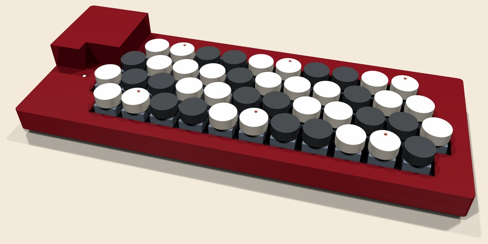
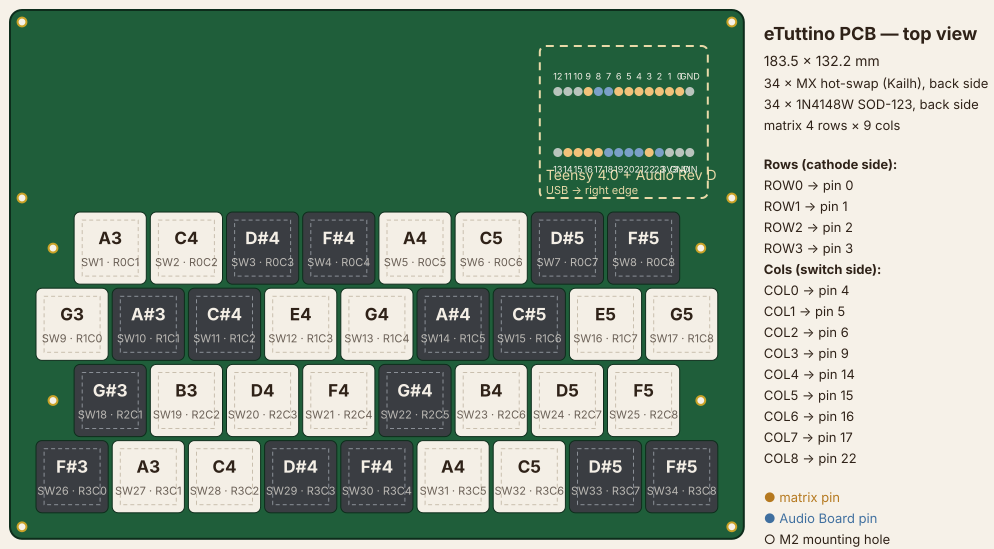

# eTuttino — PCB design (Hall-effect, velocity-sensitive)

A 44-key chromatic button-accordion controller (C-griff, G3–E6).

- **Keys:** Gateron magnetic (Hall-effect) switches, MX-compatible.
- **Sensing:** a TI DRV5056A3 linear Hall sensor under every key, so the
  firmware knows how far down each key is, and from how fast it went
  down, the note's velocity.
- **Brain:** a Teensy 4.0 with the PJRC Audio Adaptor Board Rev D stacked
  on it.

The firmware is in [`../firmware`](../firmware), the web page is
[beatconfused.com/etutti](https://beatconfused.com/etutti/), and
step-by-step **assembly and user manuals** (en/pt/es) are at
[beatconfused.com/etutti/manuais](https://beatconfused.com/etutti/manuais/).





## Ordering (ready to upload)

Everything a PCB service needs is generated, routed and checked (KiCad DRC:
0 errors, 0 warnings, 0 unconnected; firmware cross-check 44/44):

| File | Upload it as |
| --- | --- |
| [`fab/etuttino_gerbers.zip`](fab/etuttino_gerbers.zip) | **the PCB**: Gerbers + drill files. 2 layers, FR-4, **1.2 mm** |
| [`fab/etuttino_bom.csv`](fab/etuttino_bom.csv) + [`fab/etuttino_cpl_bottom.csv`](fab/etuttino_cpl_bottom.csv) | **assembly** (JLCPCB PCBA, *Bottom Side*): every SMD part is on the back |
| [`fab/etuttino_plate_gerbers.zip`](fab/etuttino_plate_gerbers.zip) | **the switch plate**: a copper-less 1.6 mm FR-4 board with the 14 mm cutouts |
| [`fab/etuttino_case_top.stl`](fab/etuttino_case_top.stl) + [`fab/etuttino_case_bottom.stl`](fab/etuttino_case_bottom.stl) | **the case**, for a 3D-printing service (mm). `.step` copies alongside for CAD |

There are two routes, both written up in the manuals:

- **A, factory-soldered:** order the PCB with JLCPCB's assembly service.
  It arrives with all 99 SMD parts soldered. You solder only the Teensy
  and the Audio Board.
- **B, home-soldered:** order the bare PCB (plus an optional bottom-side
  stencil). Buy the parts from LCSC (same numbers as the BOM) and solder
  them yourself.

The BOM carries LCSC numbers for the JLCPCB basic parts. The two TI parts
(`DRV5056A3QDBZR`, `CD74HC4067M96`) are matched by manufacturer part
number in JLCPCB's BOM tool. Check every part's rotation in the placement
preview before paying.

## Why the sensors are on the back

The DRV5056 is unipolar: its output only rises for a **south** pole facing
its marked (top) side. Gateron's magnetic switches have the magnet's
**north** pole facing down. A sensor on the front, facing up, would read
nothing.

Mounted on the back, the sensor faces away from the switch, and the field
reaches it through the board from behind. The sensor reads that as
positive. A 1.2 mm board keeps the sensor as close to the magnet as that
allows.

Gateron rates the switch at about 10 mT at rest and 90 mT bottomed out,
measured on a 1.2 mm board. Through the board it is less, so the A3
variant (30 mV/mT at 3.3 V, about 80 mT before it saturates) leaves
headroom either way. The A4 also works.

With a switch whose magnet has south facing down, the sensors would have
to move to the front.

## Source files and regenerating

| File | What it is |
| --- | --- |
| [`generate.py`](generate.py) | single source of the geometry and of the sensor → multiplexer channel map (plain Python 3). Prints the `KEY_INPUT` table for the firmware |
| [`build_pcb.py`](build_pcb.py) | builds and **routes** the KiCad board, runs DRC, checks it against the firmware, exports everything in `fab/`, then the manual's pictures (`--renders` redoes only those) |
| [`mechanics.py`](mechanics.py) | picks where the case's pillars touch the back of the board (clear of pads, vias and parts) and estimates how far the board bends under each key; writes `build/etuttino_supports.json` |
| [`case.py`](case.py) | the two-piece case, built in FreeCAD from the board geometry and those supports; writes the STL/STEP files in `fab/`. [`case_check.py`](case_check.py) then proves nothing in the case touches a keycap (over its whole travel), a switch, or the Teensy + Audio Board |
| [`assembly3d.py`](assembly3d.py) | simple VRML models of the switches, keycaps, plate, Teensy and Audio Board (with all 28 header legs), the case from its STLs, and the `kicad-cli` renders in `../manuais/img/` |
| [`etuttino.pretty/`](etuttino.pretty) | footprint library: `Gateron_Magnetic_MX_1u` (two 1.75 mm peg holes, no centre post, no pins), origin at the switch centre |
| [`kicad/etuttino.kicad_pcb`](kicad/etuttino.kicad_pcb) | the routed board. Open it in KiCad's PCB Editor to look at or tweak it |
| [`kicad/etuttino_plate.kicad_pcb`](kicad/etuttino_plate.kicad_pcb) | the plate |
| `build/etuttino_pcb_preview.svg` | top view: keys (with their multiplexer/channel), sensors, multiplexers, Teensy zone, holes |
| `build/etuttino_keys.csv` | each key: switch, sensor, note-grid row/col, multiplexer, channel and pin, Teensy pin, note, X/Y (mm) |
| `build/etuttino_plate.dxf` | the plate as DXF, for laser cutting aluminium instead of FR4 |

After changing the layout in `generate.py`, rebuild everything (about four
minutes per routing attempt; the router is pure Python and greedy, so if a
sensor output can't be routed the script starts again with that net first,
up to eight times):

```bash
python generate.py
"C:/Program Files/KiCad/10.0/bin/python.exe" build_pcb.py
```

After a successful route `build_pcb.py` also runs `mechanics.py`, then
`case.py` with FreeCAD 1.0's Python (`FREECAD_PYTHON` overrides the path),
then the renders. `build_pcb.py --renders` redoes only those three.

`build_pcb.py` exits with an error in three cases:

- DRC finds a problem;
- anything is left unconnected;
- a key's sensor doesn't reach the multiplexer channel and Teensy pin the
  firmware's `KEY_INPUT` / `MUX_COM_PINS` / `MUX_SEL_PINS` say.

If the channel map changed, paste the table `generate.py` prints into the
sketch.

## Layout

Chromatic accordion, C-griff:

- Each key along a row is a **minor third (3 semitones)** above the previous one.
- Rows are **staggered by half a key**, so a diagonal step to the next row
  is **one semitone**.
- Row 4 repeats row 1's notes from A3 to C6, on row 2's columns: its A3
  sits above row 2's A♯3 and its C6 above C♯6.
- **Row 1 is nearest the player**, at the bottom (front edge) of the board,
  and row 4 is at the top, behind it.
- The same switches also play **B-griff** (the mirror image: rows 1 and 3
  swap). The web page's C/B-griff switch tells the firmware which note
  table to use (CC 24). The PCB does not change.

| Row | Keys | Notes |
| --- | --- | --- |
| 1 | 11 | A3 C4 D♯4 F♯4 A4 C5 D♯5 F♯5 A5 C6 D♯6 |
| 2 | 12 | G3 A♯3 C♯4 E4 G4 A♯4 C♯5 E5 G5 A♯5 C♯6 E6 |
| 3 | 11 | G♯3 B3 D4 F4 G♯4 B4 D5 F5 G♯5 B5 D6 |
| 4 | 10 | A3 C4 D♯4 F♯4 A4 C5 D♯5 F♯5 A5 C6 |

Keys sit on the standard MX pitch of 19.05 mm. Rows 2 and 4 start half a key
further left than rows 1 and 3. The key area is 12 × 4 keys
(228.6 × 76.2 mm).

**Size and ergonomics.** The PCB is **267 × 97.2 mm**: the four rows, 6 mm
margins at the front and right, and a 15 mm strip at the back (multiplexer
U52 and the long lines to the far one run there). Rows 3 and 4 start after row 2,
so the **back-left corner** is free. The Teensy + Audio Board stack sits
there, with USB and the headphone jack facing the **left edge**: the cables
leave the instrument away from the right hand that plays it, the right end
stays clear for the high notes, and the power LED is just in front of the
Teensy, in the player's sight. On the Audio Board the jack sits beside the
0–12 pin row at the USB end; that was read off PJRC's pin diagram, so check
a real board before you print the case (`case.py` has the openings as
parameters). The plate is notched around the stack.

**Height.** The Audio Board is soldered about 3 mm above the PCB on its
stacking-header legs, the female headers (8.5 mm) on top of it, then the
Teensy on its male headers' 2.5 mm spacers. The Teensy's top is 17.2 mm
above the board and its USB connector 19.8 mm, against 18.8 mm for the
keycaps. The case covers it with a pod in that corner. With sockets under
the Audio Board it would end up about 6 mm taller.

**The only link between the stack and the keyboard** is the Audio Board's
28 stacking-header legs, soldered on the back of the eTuttino board. No
screws, no wires, and no part of the case touches the stack.

## Electrical

**Per key (back side):**

- a DRV5056A3 (SOT-23) straight under the switch centre;
- its 100 nF decoupling capacitor just above it;
- a 3.3 V bus above each key row and a GND bus below it (0.4 mm);
- the sensor output drops to a via and is routed to its multiplexer.

**Multiplexers:** three CD74HC4067 (SOIC-24) on the back.

- U51 sits in the front-left corner, before the start of rows 1 and 2,
  and serves row 1 and the left end of row 2. U52 lies sideways in the
  back strip just right of the Teensy, behind row 4's first keys, and
  serves the left half of the other keys; U53 sits in the back-right corner (past rows 3 and 4,
  which end earlier) and serves their right half. The router picks each
  key's channel; see `build/etuttino_keys.csv`.
- Their address lines S0–S3 are shared.
- Enable is tied to GND.

| Net | Teensy pin |
| --- | --- |
| SEL0–SEL3 (multiplexer address S0–S3) | 0, 1, 2, 3 |
| COM0 (U51 output) | 14 (A0) |
| COM1 (U52 output) | 15 (A1) |
| COM2 (U53 output) | 16 (A2) |
| VIN (USB 5 V) → regulator | VIN |
| GND | GND (both sockets) |
| LED_R_DRV / LED_G_DRV → 330 Ω (R1 / R2) → power LED D1 | 4 (red), 5 (green) |

**Power LED:** D1 is a 3 mm red/green bicolour LED (common cathode, middle
leg) on the top just in front of the Audio Board, outside the plate. The firmware
shows orange (both) while it reads all the keys at power-up, green while
playing, and blinks red on an error (codec or a key's sensor not
answering).

**Power:** 44 sensors draw about 260 mA, more than the Teensy's own 3.3 V
pin should give. An AMS1117-3.3 (U60, SOT-223, on the back between the
Teensy pin rows, input towards the VIN row) makes a separate 3.3 V rail from VIN for the sensors and
multiplexers. It has 10 µF (C80) in and 22 µF (C81) out. The sensor outputs never
exceed this rail, and the Teensy's ADC pins tolerate 3.3 V.

**Pins kept clear of:**

- 7, 8, 18–21, 23: the Audio Board Rev D audio and I²C;
- 10–13: its SD card;
- 6: its optional memory chip;
- 15 is the Audio Board's *optional* volume pot, unpopulated on a stock
  board, so COM1 can use it. If you ever fit the pot, move COM1.

Pins 17 and 22 (A3, A8) are still free, for example for a future
expression pedal or bellows sensor.

**Routing:** two layers.

- Per-key wiring and the 3.3 V / GND bus along each key row are laid
  deterministically.
- Everything else is routed by a small grid router in `build_pcb.py`:
  A* on a 0.254 mm grid aligned to the Teensy pins, both layers, vias,
  keeping KiCad's clearances. Order: the row buses to the regulator and
  the Teensy GND, then the multiplexers' outputs, address lines and
  supplies, then the 44 sensor outputs (furthest first). A net may only
  join copper already connected to its root.
- KiCad's DRC then checks the result independently.

## Teensy + Audio Board mounting

- Two rows of 14 holes (2.54 mm pitch, 15.24 mm apart) in the back-left
  corner: the 0–12 row at the front, the VIN–13 row at the back. The
  silkscreen marks "GND"/"0" and "VIN"/"23" and "< USB + jack".
- The Audio Board's stacking headers (female on top) are soldered to the
  Audio Board. Their legs then go through the eTuttino holes with the Audio
  Board about 3 mm above the PCB, and are soldered and trimmed on the back.
- The Teensy (male pins down) plugs into the stacking headers, USB to the
  left edge.
- Optional: two 1×14 female sockets on the PCB make the Audio Board
  removable, at about 6 mm more height.

## Bill of materials

| Qty | Part | Notes |
| --- | --- | --- |
| 44 | Gateron KS-20 magnetic switch (or another Gateron magnetic switch, north pole down) | plate-mounted, **not soldered**: no pins, two plastic pegs |
| 44 | DRV5056A3QDBZR, SOT-23 | back side, under each switch (A4 also works) |
| 47 | 100 nF 0805 | one per sensor + one per multiplexer |
| 2 | 330 Ω 0805 | LED resistors R1, R2 (back) |
| 1 | 3 mm LED, red/green, common cathode (3 legs) | power light D1, through-hole, top |
| 3 | CD74HC4067M96, SOIC-24 | back side |
| 1 | AMS1117-3.3, SOT-223 | back side |
| 1 + 1 | 10 µF, 22 µF 0805 | regulator input / output |
| 44 | 1u MX keycap, **round** | round MX-stem keycaps (sold as "round" or "typewriter" keycaps) give the accordion-button look of the web page. **26 light** (naturals) + **18 dark** (sharps) |
| 1 | Teensy 4.0 (+ 2 × 1×14 male headers) | |
| 1 | PJRC Audio Adaptor Board **Rev D** (+ 2 × 1×14 stacking headers) | |
| (2) | 1×14 female socket, 2.54 mm | optional, only to make the Audio Board removable |
| 1 | switch plate | 1.6 mm FR4 from `fab/etuttino_plate_gerbers.zip` (same fab as the PCB), or 1.5 mm aluminium from `build/etuttino_plate.dxf` (240.6 × 88.2 mm, notched for the stack, 14 mm cutouts) |
| 9 + 18 | M2 × 3.5 mm standoff + M2 × 4 mm screws | plate ↔ PCB (the standard 3.5 mm MX gap under a 1.5 mm plate); the board must sit right against the switch bottoms |
| 1 + 1 | case: tray + top | 3D-printed from `fab/etuttino_case_*.stl` (SLA resin, MJF nylon or PETG); see **Case** below |
| 10 | M2 × 10 mm self-tapping screws, pan head | case: 8 through the tray walls into the top, 2 through the board's two left holes into posts under the top |
| 4 | stick-on rubber feet, 10 mm | in the recesses under the tray |

## Assembly

See the manuals at
[beatconfused.com/etutti/manuais](https://beatconfused.com/etutti/manuais/)
(source: [`../manuais/index.html`](../manuais/index.html)). The short
version:

1. Back side SMD: multiplexers (pin 1!), regulator, its two capacitors,
   sensors, 100 nF capacitors. Route A skips this step.
2. Audio Board on its stacking headers, about 3 mm above the front of the board, soldered and trimmed on the back.
3. Teensy plugged into the Audio Board, USB to the left. Flash
   `firmware/etutti_synth` (USB Type: MIDI).
4. On the web page, turn on **Key test** and sweep a small magnet over each
   key position from the top. Every ring should fill.
5. Switches into the plate. Plate onto the PCB on 3.5 mm standoffs.
   Keycaps.
6. Board assembly into the case tray, top on, ten M2 screws from below.
7. Replug the USB (rest is measured at start-up), click **Calibrate keys**,
   and press every key to the bottom once.

## Case

Two 3D-printed parts, generated by `case.py` from the same geometry (outer
size 278 × 108 mm; 15.7 mm to the deck, keycaps on top, 33 mm at the pod):

- **Tray** (under the board): 2 mm floor, 4.5 mm of room under the board for
  the parts and the trimmed legs, a boss under every mounting hole (with a
  pocket for the plate-standoff screw head, or a through hole and
  counterbore for the two screws that hold the top), recesses for four
  rubber feet, and the support pillars below.
- **Top**: 5 mm walls plus a 3 mm deck resting on the plate's edge, with one
  stepped opening that follows the four staggered rows (0.6 mm round each
  key's 19.05 mm cell, so the round keycaps never touch it), pockets for the
  plate screws, the power-LED window, two posts at the board's left holes,
  and a pod over the stack: 1 mm clear of row 3's first keycap, open on the
  left for the USB plug (13 × 9 mm, room for the overmould) and the 3.5 mm
  jack (Ø 7.2 mm). Over the Audio Board the deck's underside is raised to
  6 mm above the PCB.

Where to get it printed (each part is 278 mm long, beyond most home
printers' 256 mm beds): [JLC3DP](https://jlc3dp.com/) (ships with the JLCPCB
boards; SLA resin or MJF PA12 nylon), [PCBWay](https://www.pcbway.com/rapid-prototyping/3d-printing/),
[Craftcloud](https://craftcloud3d.com/) (compares many printers, local ones
too), or any local service with a 300 mm FDM printer (PETG, 0.2 mm layers,
4 walls). Print the top deck-down and the tray floor-down.

## Stiffness

The switches stand on the board, so a key press pushes the 1.2 mm PCB down
right under the sensor. Held only at its mounting holes, all near the
edges, the board would sag about 2.62 mm under a firm 3 N press (worst:
C5 row 1). `mechanics.py` places **43 pillars** in the tray along the
gaps between key rows and the front/back margins, each where the back of
the board has only solder-masked traces (at least 0.6 mm from any pad, via
or part), and checks the result with a grillage model of the bare board
(4 mm beam mesh, E = 18 GPa, no twisting stiffness, the plate's help
ignored, so it overestimates): worst key **0.027 mm** (C4 row 4),
mean 0.014 mm. The numbers per key are in `build/etuttino_supports.json`.
