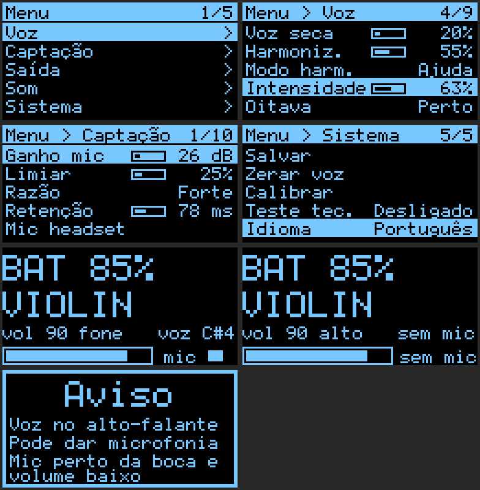
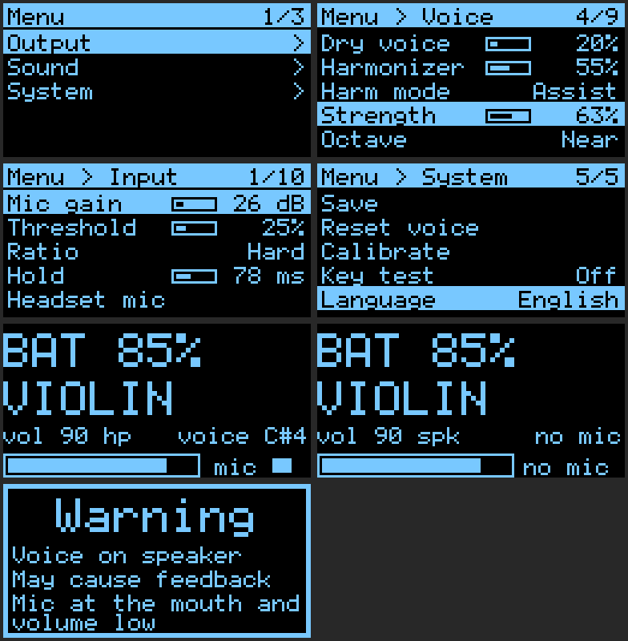
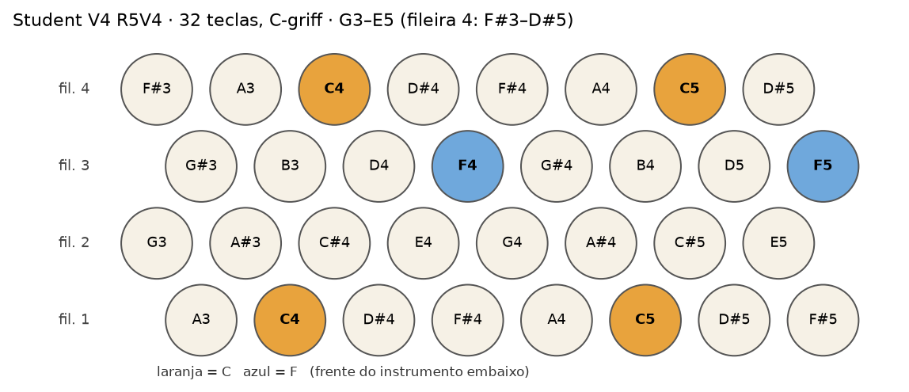

# eTutti Student V4 · firmware e som (R1V4 + R2V4 + R3V4 + R4V4 + R5V4 + R6V4)

21 nov 2026. **R4V4 (atendida nesta revisão):** voz só no fone/AUX por padrão, expansor e supressor de microfonia, harmonizador que segue a tecla, menu pelos dois knobs na OLED e varredura em `IntervalTimer`: ver a seção **"R4V4"** logo abaixo. O resto do texto (R1V4, R2V4 e R3V4) continua valendo, com as correções marcadas "(R4V4)". **R3V4:** varredura com ADC duplo e leitura quente em rodízio (item 5) e voz com efeitos junto com o teclado (item 6): ver a seção **"R3V4"** adiante. Atende as tarefas **P1** (capacidade do Teensy MicroMod para 76 teclas, Full Speed USB) e **P2** (começo do firmware V4, §9 itens 1–3) da **R1V4**, com a varredura da **R2V4** (F2: réguas de 4 teclas, 4 linhas OUT, cadeia de registradores de deslocamento).

**O firmware compila para a V4 (28, 44, 60 e 76 teclas), para o Student V01 e para o eTuttino (R4V4: de novo, com a varredura em interrupção). Nada foi gravado e nada rodou numa placa: a V4 não existe.** Tudo o que é tempo medido abaixo é **conta** (marcada "estimado"), a partir das medições do eTuttino (CLAUDE.md) e dos números do datasheet que o repositório já traz. Os pinos e o contrato de varredura seguem o `student_v04/pcb/PINOS.md` (rascunho da eletrônica, 74HC595 C5947, SCAN_DATA = 2, SCAN_CLK = 3); o que o PINOS.md ainda marca "(conferir)" continua a conferir.

**R5V4 (atendida nesta revisão):** teclado de 32 / 48 / 64 / 80 teclas com réguas sempre cheias, mapa de notas e equalização do alto-falante de estudo: ver a seção **"R5V4"** logo abaixo. **Onde o texto mais antigo fala em 28 / 44 / 60 / 76 teclas (ou em posições sem tecla), vale a R5V4: 32 / 48 / 64 / 80, todas as posições com tecla; as colunas, as passadas e a CPU da varredura são as mesmas.**

**R6V4 (atendida nesta revisão):** voz só com microfone no IN, padrão headset, harmonizador de 3 modos com até 4 vozes e tela em português e inglês com acentos: ver a seção **"R6V4"** logo abaixo. Onde as seções antigas falam em tela só com maiúsculas e sem acento, ou em 3 vozes, vale a R6V4.

## R6V4 · voz só com microfone (item 5), harmonizador de 3 modos e até 4 vozes (item 6), tela em português e inglês (item 7)

**Atende a SPEC R6V4** (itens 5, 6, 7 e 8; os itens 1 a 4 não são da programação). **Compila** (V4 32/48/64/80, Student V01 e eTuttino; tabela no fim desta seção). **Nada gravado e nada rodou numa placa**: CPU, latência e níveis do microfone são **conta** (marcados "estimado"). As telas abaixo foram desenhadas com os dados reais da fonte (`img/tela_pt.png`, `img/tela_en.png`, gerados por `etutti/firmware/tools/oled_font/render_screens.py`), mas **não vistas num SSD1306**.

### 1 · Item 5: microfone na entrada IN, padrão headset a 2–3 cm

**Regra.** Os efeitos de voz (expansor, harmonizador, supressor de microfonia, vocoder, eco, reverb da voz) só funcionam com **um microfone ligado no IN (J302)**. Sem microfone:
- as páginas **Voz** e **Captação** somem do menu, e também as linhas **Saída voz** e **Teclas** (nível do teclado na mistura da voz), porque só existem para a voz; o resto fica como está;
- `voiceFxApply()` cala tudo da voz (`voiceBlocked()` = sem plugue de fone/AUX, ou sem microfone): o expansor, o vocoder, os deslocadores, o rastreador de afinação e a FFT do supressor deixam de rodar (CPU 0);
- a tela principal mostra `sem mic` (no lugar da barra de nível do microfone e, se algum efeito de voz estiver ajustado, na linha do volume); os ajustes ficam guardados e voltam ao plugar o microfone;
- um CC de voz vindo da página ainda é aceito e guardado, mas nada soa.

**Como o plugue é detectado** (resposta da eletrônica, `pcb/PINOS.md` seção R6V4; `V4_MIC_DETECT 2`): o pino **25 (MIC_DET, ADC)** lê a tensão CC da ponta do jack (R306 100 k + C311 100 nF). Com o MIC_BIAS a 3,0 V e 4,2 kΩ em série:

| Tensão no pino | O que há no jack | Efeitos de voz |
|---|---|---|
| >= 2,85 V | nada, ou plugue de linha (sem carga CC) | **desligados** |
| 0,30 V < v < 2,85 V | cápsula de eletreto (0,1 / 0,3 / 0,5 mA = 2,6 / 1,7 / 0,9 V) | **liberados** |
| <= 0,30 V | curto, ou dinâmico de baixa impedância | desligados |

Leitura a cada 50 ms, **3 leituras iguais** para mudar (antirruído); os limiares são conta e **precisam ser medidos** com um eletreto e um plugue de linha de verdade (pergunta 1). Resposta à pergunta do Chat: **o hardware distingue microfone de plugue de linha** (pelo CC), mas **não** o microfone de PC com bias no anel (a ponta só tem sinal; J302 pino 6 NC), como a eletrônica anotou. **VOL_SW passou do pino 25 para o 4** na mesma revisão: o sketch já usa o 4 na V4 (a V01 continua no 25). Sem a detecção (`V4_MIC_DETECT 0`) assume-se sempre um microfone; o modo 1 (digital) ficou só para uma placa sem o R306.

**Padrão de fábrica = headset a 2–3 cm da boca** (`VoiceFx`; a ação **Mic headset** do menu Captação volta a estes valores):

| Ajuste | Antes (R4V4) | **Fábrica R6V4** |
|---|---:|---:|
| Ganho do microfone | 35 dB | **26 dB** |
| Limiar do expansor | 240 | **~550** (valor 32) |
| Razão | forte (n = 3) | forte (n = 3) |
| Ataque / retenção / soltura | 2 / 63 / 143 ms | **1,2 / 78 / 117 ms** |
| Passa-altas | 89 Hz | **167 Hz** |
| Supressor de microfonia | desligado | **desligado** |
| Voz no alto-falante | desligada, **nunca salva** | desligada, **nunca salva** |

Conta (estimada): cápsula de -42 dBV/Pa (~8 mV/Pa); voz a 60 dB SPL a 1 m = 0,02 Pa, a 2,5 cm são +32 dB = ~0,8 Pa (92 dB SPL) = 6,3 mV rms; o pré-amplificador do codec a 26 dB (x20) dá ~126 mV; a plena escala do ADC do SGTL5000 a 0 dB é ~0,9 Vrms (conferir), logo **~0,14 da escala, rms ~4600 em int16, pico ~14 000** (sem corte; a 35 dB a mesma voz daria rms ~13 000 e cortaria). O som do alto-falante a ~30 cm do mic (70 dB SPL = 0,063 Pa) chega 22 dB abaixo: nível retificado ~300, **abaixo do limiar 550** (cai ~16 dB com a razão cúbica); sílabas suaves da voz (-15 dB do médio) ainda ficam em ~650, acima do limiar. É um **ponto de partida de conta, não ouvido**: a regulagem certa é na placa com a cápsula escolhida.

### 2 · Item 6: harmonizador que segue a tecla, 3 modos, 3 ou 4 vozes

Menu **Voz > Modo harm.** gira por: **Fixo** (intervalo fixo em semitons, como antes), **Exato**, **Ajuda**, **Intervalo**. CCs: 95 (seguir liga/desliga), **108 modo (valor/32: 0 exato, 1 ajuda, 2 intervalo)**, **109 intensidade da ajuda (0..127)**, **110 vozes (>= 64 = 4)**, 97 oitava (perto/exata). Só no sketch, como os outros CCs de voz.

| Modo | O que faz | Linhas do menu |
|---|---|---|
| **Exato** | cada nota segurada ganha um deslocador que põe a voz **exatamente** na nota (razão = Hz da nota / Hz da voz). Vários dedos = acorde cantado | Oitava, Vozes |
| **Ajuda** | **um** deslocador: a nota segurada **mais perto da voz** (dentro de 3 semitons, ignorando oitavas) puxa a voz só em parte: deslocamento = intensidade x (nota - voz) em semitons (127 = exato, 0 = nada). Enquanto soa, a voz seca faz um fade para fora (~40 ms), para ouvir só a voz ajudada | **Intensidade** (padrão 63 %), Vozes |
| **Intervalo** | a voz fica **natural**: a nota mais perto da voz é a referência ("onde o cantor está") e cada **outra** nota segurada ganha um deslocador de exatamente (nota - referência) semitons: mantém a distância entre as teclas, sem tocar na afinação nem no vibrato do cantor. Uma só tecla = silêncio | Oitava (perto: deslocamento dentro de ±6; senão até ±12), Vozes |

**Até 4 vozes** (**Vozes 3 / 4**, padrão 3). Há 4 deslocadores (`VOICE_HARM_N = 4`, 25,6 KB de RAM2 cada); com 3 o quarto fica parado (CPU 0). Em Intervalo, com N vozes o sketch lê N+1 teclas (uma é a referência). O detector de afinação (YIN) precisa ser bom em Exato e Ajuda; no Intervalo só escolhe a referência. As linhas que não valem no modo atual somem do menu (Intervalo em semitons só no modo Fixo; Intensidade só na Ajuda; Oitava e Vozes só quando segue a tecla).

**Medidas (compiladas) e estimativas** (V4 de 32 teclas; 48/64/80 somam 32 bytes de RAM1 por 16 teclas, tabela no fim):

| | R5V4 | **R6V4** | |
|---|---:|---:|---|
| Código em flash | 143 088 B | **146 096 B** | +3,0 KB (fonte com acentos, textos, 3 modos) |
| RAM1 (variáveis) | 106 400 B | **108 576 B** | +2,2 KB |
| RAM2 | 175 648 B | **202 272 B** | +26,6 KB (o 4º deslocador, 25,6 KB) |
| `AudioMemory` | 100 | **104** | estimado (+4 blocos para o 4º deslocador); medir `AudioMemoryUsageMax()` |

Folga: RAM1 ~252 KB, RAM2 ~322 KB: cabe com muita folga.

| Estimado, 396 MHz | CPU |
|---|---:|
| Harmonizador Exato com **4 notas** (YIN 1,2 % + filtro 0,1 % + 4 x 0,3 %) | **~2,5 %** (3 notas ~2,2 %) |
| Ajuda (YIN + 1 deslocador) | ~1,6 % |
| Intervalo com 4 vozes | ~2,5 % |
| **Pior caso, tudo ligado** (acordeão de **4 registros** com 8 notas 30 % + voz, vocoder, eco e reverb 5,5 % + harmonizador de 4 vozes 2,5 % + supressor 1,7 % + expansor 0,2 % + EQ 0,45 % + varredura 19 %, igual para 32 a 80 teclas) | **~60 %** (R5V4: ~59,5 %) |

**Cabe a 396 MHz** (estimado): o áudio fica com ~81 % da CPU (a varredura leva ~19 %) e o pior caso precisa de ~41 %; o critério de passar a 600 MHz continua o da R4V4 (`AudioProcessorUsageMax()` acima de ~80 %). A varredura é em interrupção acima do áudio, então a latência das **teclas** não muda com 4 vozes (nota ~1 ms + bloco de áudio 2,9 ms). **Latência da voz (estimada):** a voz harmonizada sai ~25–30 ms atrás da seca (grão de 25 ms + bloco); uma tecla nova se ouve em ~40 ms (laço de 12 ms + grão + bloco); em Exato e Ajuda uma mudança de nota do cantor leva ~60 ms para a harmonia seguir; em Intervalo a razão é fixa e só a troca da referência leva ~60 ms. **O `V4_BENCH` mede** estas CPUs quando houver placa (passos novos: 4 vozes em Exato, Intervalo e Ajuda).

### 3 · Item 7: tela em português e inglês, com minúsculas e acentos

- **Fonte nova** 5 x 10 (`oled_font.h`, gerada por `etutti/firmware/tools/oled_font/make_font.py`): ASCII 32..126 mais as letras latinas com acento (à á â ã ä ç è é ê ë ì í î ï ñ ò ó ô õ ö ù ú û ü, as maiúsculas, ¡ ¿): **~1,6 KB** de flash (a SPEC estimava ~2 KB). Texto em **UTF-8**; maiúsculas nas linhas 2–8, minúsculas nas 4–8, acento acima, descendente de 1 linha. Uma linha do menu continua com 10 px, **5 linhas por tela**.
- **Idioma:** menu **Sistema > Idioma** (Português / English), **gravado na hora na EEPROM** (endereço 250, marca 0xB1; sem precisar de Salvar). Padrão: português. O nome de cada idioma é escrito no próprio idioma.
- **Tabela de textos fácil de estender:** `ui_text.h` tem o enum de idiomas (`LANG_PT, LANG_EN`), `LANG_NAME[]`, a tabela `STR[]` das frases soltas e os tipos do menu; as linhas do menu (`ITEMS_*` no sketch) e as listas de valores são `{"português", "inglês"}`. **Para um idioma novo:** pôr o código no enum, o nome em `LANG_NAME` e **um texto a mais em cada `{...}`** (o que faltar cai para o inglês); se usar letras que a fonte não tem, acrescentá-las em `make_font.py`.
- Nomes dos registros e dos instrumentos (Bassoon, Violin...) continuam em inglês maiúsculo, como na página.

**Telas** (`img/tela_pt.png` e `img/tela_en.png`: menu principal sem microfone, Voz, Captação, Sistema, tela principal com e sem microfone, aviso). Em texto, português (`[...]` = linha invertida):





```
MENU (com microfone)               MENU > VOZ (modo Ajuda)
[Menu                  1/5]        [Menu > Voz            4/9]
[Voz                     >]         Voz seca     [=   ]    20%
 Captação                 >         Harmoniz.    [==  ]    55%
 Saída                    >         Modo harm.            Ajuda
 Som                      >        [Intensidade  [==  ]    63%]   <- só na Ajuda
 Sistema                  >         Oitava                Perto

MENU (sem microfone)               MENU > SISTEMA
[Menu                  1/3]        [Menu > Sistema        5/5]
[Saída                   >]         Salvar
 Som                      >         Zerar voz
 Sistema                  >         Calibrar
                                    Teste tec.        Desligado
TELA PRINCIPAL                     [Idioma            Português]
 BAT 85%      (corpo 2x)
 VIOLIN       (corpo 2x)           MENU > CAPTAÇÃO
 vol 90 fone         voz C#4       [Menu > Captação      1/10]
 [=========]  mic [==]             [Ganho mic   [=   ]  26 dB]
 (sem microfone: "sem mic" no lugar da barra do mic)
```

Em inglês: `Menu > Voice`, `Dry voice`, `Harmonizer`, `Harm mode` (`Fixed / Exact / Assist / Interval`), `Strength`, `Octave` (`Near / Exact`), `Menu > Input` (`Mic gain`, `Threshold`, `Ratio`, `Headset mic`), `Menu > System` (`Save`, `Reset voice`, `Calibrate`, `Key test`, `Language English`), tela principal `vol 90 hp`, `voice C#4`, `no mic`.

**Item 8 (sem mudança):** o clique curto do seletor age **ao soltar** (o longo de 0,7 s abre o menu) e o alto-falante da voz **nunca é salvo ligado** (cada partida volta ao fone/AUX); conferido no código.

**Persistência:** SALVAR guarda agora também modo, intensidade e 3/4 vozes (EEPROM 210, bytes 26 a 29, atrás da marca `0xE6`; dados antigos continuam valendo). O supressor, se o J o ligar e salvar, volta ligado; a fábrica é desligado.

### Conferências da R6V4

| Compilação (`--fqbn teensy:avr:teensyMM:usb=midi,speed=396`, nada gravado) | Código (flash) | RAM1 (variáveis) | RAM2 |
|---|---:|---:|---:|
| V4 32 teclas | 146 096 B | 108 576 B | 202 272 B |
| V4 48 teclas | 146 096 B | 108 608 B | 202 272 B |
| V4 64 teclas | 146 096 B | 108 640 B | 202 272 B |
| V4 80 teclas | 146 096 B | 108 672 B | 202 272 B |
| V4 32 com `V4_BENCH 1` (`usb=serialmidi`) | 147 696 B | 108 352 B | (compila) |
| Student V01 | 90 040 B (igual) | 65 760 B | 22 400 B |
| eTuttino (Teensy 4.0, `usb=midi`) | 88 824 B (igual) | 65 664 B | 22 400 B |


| Conferência | Resultado |
|---|---|
| `pcb/PINOS.md` relido no fim | seção R6V4: **MIC_DET = pino 25 (ADC)** e **VOL_SW = pino 4**; o sketch segue as duas coisas (a V01 continua com VOL_SW no 25); os demais pinos sem mudança |
| Telas | desenhadas com a fonte real; **não vistas** num SSD1306 |
| Microfone, CPU, latência | **estimados** (contas acima) |


---

## R5V4 · réguas sempre cheias (32 / 48 / 64 / 80 teclas) e equalização do alto-falante de estudo

Tarefa 4 da SPEC R5V4. **Compila** (V4 com 32, 48, 64 e 80 teclas, Student V01 e eTuttino; tabela em "Conferências da R5V4"). **Nada gravado e nada rodou em placa.** Tempos e CPU são **estimados** (conta), como nas revisões anteriores. A tela, o menu e o resto da voz seguem como na R4V4 (o menu está **como no §4 desta revisão anterior, sem mudança**; só ganhou 3 linhas da EQ, abaixo).

### 1 · Teclado de 32 teclas, mapa de notas

Mudanças no sketch (`ETUTTI_STUDENT_V4 1`):
- `V4_KEYS` = **32, 48, 64 ou 80** (outro valor dá `#error`); `V4_STRIPS_PER_ROW = (V4_KEYS - 32) / 16 + 2`. `MAX_KEYS` = 80.
- **Toda posição de toda régua tem tecla** (`v4HasKey()` é sempre verdadeiro): 8 / 12 / 16 / 20 teclas em cada uma das 4 fileiras. Acabaram as "posições sem tecla" no fim da fileira (a R3V4 tinha 7/8/7/6).
- `FIRST_COL = {0, 0, 0, 0}` (igual; a régua começa na primeira tecla da fileira). **`FIRST_NOTE` da V4: C-griff `{57, 55, 56, 54}` (A3, G3, G#3, F#3), B-griff `{56, 55, 57, 53}`.** A fileira 4 deixa de começar em A3 e passa a começar em **F#3**, uma coluna à esquerda da nota que a fileira 1 teria ali: está nas colunas da fileira 2 e um semitom abaixo dela em cada coluna (F#3 sob G3). No B-griff (CC 24: fileiras 1 e 3 trocadas) a fileira 4 acompanha a fileira 1, como no eTuttino: F3. O eTuttino e o Student V01 mantêm `{57, 55, 56, 57}`.
- Chave da EEPROM de calibração: `0xE7770107` (a ordem das teclas mudou de contagem e de posição). 4 + 2 × 80 = 164 bytes, ainda antes do endereço 200 (registro) e do 210 (voz).
- Colunas, cadeia de registradores e varredura **não mudam de forma**: cada régua tem 4 colunas, então 32 = 8 colunas (2 réguas por fileira), 48 = 12, 64 = 16, 80 = 20, e a cadeia tem 8 × N estágios por fileira (16 / 24 / 32 / 40) com **as 4 posições (QA..QD) de todas as réguas agora ligadas a uma tecla**. O acesso aleatório continua 8 N + 1 pulsos: **17 / 25 / 33 / 41** (~10 µs a 5 MHz com 80 teclas). Entre réguas o "1" ainda passa por 4 estágios mortos (QE..QH), 5 pulsos da coluna 3 para a 4.

**Ordem padrão das oitavas por módulo** (R1V4 §4.4, mantida pela R5V4 item 1): o 1º módulo extra vai para o agudo, o 2º para o grave, o 3º agudo de novo. O que decidi para 48 / 64 / 80, coerente com isso e conferido por script contra a regra (nota = `FIRST_NOTE[fileira] + 3 × coluna + transposição`):

| Teclas | Colunas | Transposição (`noteShift`) | Fileira 1 | Fileira 2 | Fileira 3 | Fileira 4 |
|---:|---:|---:|---|---|---|---|
| 32 | 8 | 0 | A3–F#5 | G3–E5 | G#3–F5 | F#3–D#5 |
| 48 | 12 | 0 (módulo 1 = agudo) | A3–F#6 | G3–E6 | G#3–F6 | F#3–D#6 |
| 64 | 16 | −12 (módulo 2 = grave: o teclado inteiro desce uma oitava) | A2–F#6 | G2–E6 | G#2–F6 | F#2–D#6 |
| 80 | 20 | −12 (módulo 3 = agudo) | A2–F#7 | G2–E7 | G#2–F7 | F#2–D#7 |

(Faixa da fileira 2 = a que a SPEC cita: 32 = G3–E5, 48 = G3–E6, 64 = G2–E6, 80 = G2–E7. A tecla mais grave de todas é a F#3 da fileira 4, ou F#2 com 64 e 80.) **Na prática**, como na R1V4, a versão de 64 toca o teclado transposto uma oitava abaixo.

**Figuras** (nome da nota em cada tecla; **C em laranja, F em azul**; fileira 1 na frente, embaixo):
- `student_v04/img/mapa_notas_32.png`: as 32 teclas, C-griff.
- `student_v04/img/mapa_notas_32_48_64_80.png`: as quatro versões, com a transposição de cada uma.

(Geradas por script a partir da mesma tabela do sketch: `FIRST_NOTE` {57, 55, 56, 54}, 3 semitons por coluna; as figuras não têm planta de furos, só o mapa de notas. Os módulos entram sempre à direita, e a coluna 0 é a régua mais perto da placa principal.)



### 2 · Tempos de passada, velocity e CPU (32 e 80 teclas; estimados)

O número de **colunas** é o que manda no tempo, e ele **não mudou** (32 = 8 colunas como as 28 de antes, 80 = 20 como as 76). A passada nominal do `IntervalTimer` (~72 µs por coluna: 60 µs de acordar + ~12 µs de leitura e processamento) fica igual; o que sobe é só o processamento de 4 teclas por coluna em todas as colunas (antes havia colunas com 3, 2 ou 1 teclas), ~+0,3 µs por coluna, abaixo da resolução da conta.

| Teclas | Colunas | Passada nominal, sem tecla quente | Frequência | Rodada quente (troca de coluna / mesma) |
|---:|---:|---:|---:|---|
| **32** | 8 | **~0,58 ms** | 1,7 kHz | 81 / 56 µs |
| 48 | 12 | ~0,86 ms | 1,2 kHz | |
| 64 | 16 | ~1,15 ms | 0,87 kHz | |
| **80** | 20 | **~1,44 ms** | 0,69 kHz | 87 / 56 µs |

(tON 60 µs. Com tON 45 µs: ~0,45 / 0,67 / 0,89 / 1,11 ms.) Intervalo máximo entre duas leituras de uma tecla, com orçamento quente cheio: ~2,2 ms em qualquer carga de áudio, nas quatro versões (a varredura em interrupção não é alongada pelo áudio).

**Erro de velocity** (± unidades, convenção da R3V4: ¼ do período por cruzamento, dois cruzamentos independentes; 1 ms = 127, 80 ms = 1, ~28,8 unidades por "e" de tempo, 1 batida de 1 ms = 14,6 / t):

| Leitura | batida de 1 ms | 2 ms | 5 ms | 10 ms |
|---|---:|---:|---:|---:|
| passada de 32 teclas (0,58 ms) | 5,9 | 2,9 | 1,2 | 0,6 |
| passada de 80 teclas (1,44 ms) | 14,6 | 7,3 | 2,9 | 1,5 |
| leitura quente, 1 coluna | 0,6 | 0,3 | 0,1 | 0,1 |
| leitura quente, acorde de 2 colunas | 1,7 | 0,9 | 0,3 | 0,2 |
| leitura quente, 3 colunas | 2,6 | 1,3 | 0,5 | 0,3 |
| leitura quente, 4 colunas | 3,5 | 1,7 | 0,7 | 0,3 |

Igual ao que já valia para 28 e 76 (as passadas são as mesmas). Uma batida de 1 ms não é de dedo: o mais rápido que se toca fica em 3–5 ms, onde a leitura quente dá ±0,1 a ±0,7 em qualquer versão.

**CPU (396 MHz, estimada):** a varredura em interrupção custa ~19 % com qualquer número de teclas (o que conta é a taxa de colunas, 1 a cada 72 µs, e não o número de colunas). Síntese, voz e efeitos como na R4V4. **Equalização do alto-falante: ~+0,4 a 0,5 % só quando o alto-falante é a saída** (4 estágios biquad × ~10 ciclos por amostra × 44 117 amostras/s ≈ 1,8 M ciclos/s ≈ 0,45 % a 396 MHz; com fone ou AUX ela é desconectada e custa 0). **Pior caso, tudo ligado, ~59,5 %** (R4V4: ~59 %): 396 MHz continua bastando (estimado); o mesmo critério da R4V4 vale para passar a 600 MHz (`AudioProcessorUsageMax()` acima de ~80 %). A CPU das 80 teclas é igual à das 32: a passada é a mesma frequência de colunas e o laço processa as teclas por coluna.

### 3 · Equalização do alto-falante de estudo (SPEC R5V4 item 2)

**Conceito (aprovado pelo J):** o alto-falante da V4 é de estudo; o som completo é para fone e AUX. A equalização existe só no caminho do alto-falante.

**Onde fica no sinal.** O MAX98357A (alto-falante) e o SGTL5000 (fone/AUX) recebem **o mesmo fluxo I²S** (`outAmp` → `i2sOut`). Por isso "só no alto-falante" é feito pelo estado do jack: **sem plugue no OUT (HP_DET), o alto-falante é a saída e o fluxo passa pelo equalizador; com plugue, o equalizador é desconectado** (`pl`/`pr` ligam o volume direto ao I²S, como antes) e o fone/AUX recebe o som completo. A troca acompanha o jack em tempo real (`voiceFxApply()` já roda a cada mudança do jack) e é feita desconectando e reconectando `AudioConnection`s (o mesmo mecanismo do supressor de microfonia). A V01 e o eTuttino não têm essa parte (`V4_SPEAKER_EQ` só existe na V4).

**Filtros** (`AudioFilterBiquad spkEq`, 4 estágios, receitas do *Audio EQ Cookbook*; o biquad é o filtro que vale no projeto, não o SVF):

| Estágio | Filtro | Padrão | Ajuste |
|---:|---|---|---|
| 0 e 1 | passa-altas de 4ª ordem (Butterworth: dois biquads, Q 0,5412 e 1,3066) = **24 dB/oitava** | 300 Hz | **150 a 450 Hz** (CC 106 / menu CORTE) |
| 2 | peaking de corte em **1 kHz**, Q 1,2 | −6 dB | **0 a −12 dB** (CC 107 / menu PICO 1K) |
| 3 | passagem (b0 = 1) | | |

Resposta calculada (numpy, mesmos coeficientes e taxa de 44 117 Hz), em dB:

| Hz | 100 | 150 | 196 (G3) | 300 | 500 | 800 | 1000 | 1250 | 2000 | 4000 |
|---|---:|---:|---:|---:|---:|---:|---:|---:|---:|---:|
| padrão (300 Hz, −6 dB) | −38,2 | −24,2 | −15,1 | −3,5 | −1,5 | −4,6 | **−6,0** | −4,6 | −1,4 | −0,3 |
| mínimo (150 Hz, 0 dB) | −14,3 | −3,0 | −0,5 | 0,0 | 0,0 | 0,0 | 0,0 | 0,0 | 0,0 | 0,0 |
| máximo (450 Hz, −12 dB) | −52,4 | −38,4 | −29,3 | −15,3 | −4,7 | −9,0 | **−12,0** | −8,9 | −3,1 | −0,7 |

No padrão a nota mais grave (G3, 196 Hz) sai ~15 dB mais baixa no alto-falante: a fundamental quase some, mas os harmônicos (392, 588 Hz...) passam, e o ouvido "reconstrói" a nota. O padrão é um **ponto de partida de conta**; o ajuste certo é de ouvido na placa (pergunta 1).

**Controles.** CC **105** (liga/desliga, >= 64 liga; **padrão ligado**, não faz nada com fone), CC **106** (corte, 0..127 = 150..450 Hz, padrão 63 = ~300 Hz), CC **107** (corte do pico de 1 kHz, 0..127 = 0..−12 dB, padrão 63 = −6 dB). Livres no mapa (98–101 são NRPN/RPN do MIDI e foram evitados; 102–104 já são da synth). O menu devolve o CC quando o usuário muda um valor, como os outros. Os coeficientes são recalculados só quando um valor muda.

**Menu (SAIDA, agora com 6 linhas: a janela rola):**

```
MENU > SAIDA                    1/6
 VOLUME     [===] 71%
 SAIDA VOZ        FONE/AUX
 TECLAS     [====]100%
 EQ ALTOF.        LIGADO        <- novo: liga/desliga (CC 105)
 CORTE      [=== ] 300 HZ       <- novo: 150..450 Hz   (CC 106)
 PICO 1K    [=== ]  -6 DB       <- novo: 0..-12 dB     (CC 107)
```

**Persistência:** SALVAR guarda os três valores (EEPROM 210, bytes 22 a 25, atrás de um marcador `0xE5`: dados antigos sem o marcador continuam valendo com a EQ no padrão). ZERAR VOZ volta ao padrão (ligada, 300 Hz, −6 dB).

**Memória:** a EQ soma ~3 KB de código; o `AudioFilterBiquad` guarda só 4 estágios de estado (centenas de bytes).

### CCs novos desta revisão (só no sketch)

105 EQ do alto-falante (liga/desliga), 106 corte da EQ, 107 pico de 1 kHz. O `script.js` continua sem modelo V4: o mapa muda nos dois lados junto quando a página V4 entrar (simulação web do menu e dos knobs, fase futura).

### Conferências da R5V4

Compilado numa cópia do sketch em que só trocam `ETUTTI_STUDENT_V4` (0 para 1) e `V4_KEYS` (o sketch do repositório continua em `ETUTTI_STUDENT_V4 0`, `V4_KEYS 32`), com `arduino-cli compile --fqbn teensy:avr:teensyMM:usb=midi,speed=396` (V4 e V01) e `teensy:avr:teensy40:usb=midi` (eTuttino). **Nada gravado em placa.**

| Conferência | Resultado |
|---|---|
| V4 com 32 teclas | compila: flash 143 088 bytes de código, RAM1 106 400 bytes de variáveis, RAM2 175 648 |
| V4 com 48 teclas | compila: igual, RAM1 106 432 |
| V4 com 64 teclas | compila: igual, RAM1 106 464 |
| V4 com 80 teclas | compila: igual, RAM1 106 496 (cada 16 teclas somam 32 bytes de RAM1) |
| Student V01 (`ETUTTI_STUDENT_V4 0`) | compila, código 90 040 bytes (igual ao de antes) |
| eTuttino (Teensy 4.0) | compila, código 88 824 bytes (igual ao de antes) |

| Mapa de notas das quatro versões × R1V4 §4.4 e R5V4 item 1 | igual (script) |
| `pcb/PINOS.md` relido no fim desta revisão | sem mudança desde a R3V4 (último commit do arquivo = R3V4, sem edição pendente; ainda diz 28/44/60/76 e 'posições sem tecla', a eletrônica atualiza para a R5V4); os pinos do sketch continuam os do contrato (OUT_R1..R4 14/15/26/27, SCAN_DATA/CLK 2/3, knobs, I2S, I2C, KEEP, AMP_SD, HP_DET, VBAT, CHG_STAT 0); nenhum pino novo; J601-J604 ainda não citados |
| Resposta da EQ | calculada em numpy (tabela acima); **não ouvida**, nada rodou em placa |

---

## R4V4 · voz sem microfonia, harmonizador que segue a tecla, menu pelos knobs e varredura em interrupção

Tudo abaixo **compila** (V4 com 28, 44, 60 e 76 teclas, Student V01 e eTuttino; ver "Conferências"). **Nada foi gravado e nada rodou numa placa**: todo tempo e toda CPU são **estimados** (conta a partir das medições do eTuttino e do ciclo do ADC), exceto o que está dito "simulado" (o detector de afinação, num gêmeo em numpy) e "compilado" (memória). Os efeitos novos entram no `V4_BENCH`, que mede a CPU quando houver placa.

### Resumo das cinco tarefas

| # | Tarefa da R4V4 | Feito | Onde |
|---|---|---|---|
| 1 | Voz só no fone/AUX por padrão; alto-falante opcional com aviso | sim | `speakerMutesVoice()`, CC 96, tela de aviso |
| 2 | Filtro de amplitude (expansor com ataque, retenção, soltura, passa-altas) e estudo do supressor de microfonia | sim, e o supressor **implementado** atrás de `V4_FEEDBACK_SUPPRESSOR` | `voice_fx.h`: `VoiceInput`, `FeedbackWatch` |
| 3 | Harmonizador que segue a tecla (YIN) | sim, até 3 notas ao mesmo tempo, mantém o modo de intervalo fixo | `voice_fx.h`: `PitchTracker`; `harmFollowUpdate()` |
| 4 | Menu pelos 2 knobs na OLED 128 x 64 | sim (árvore e telas abaixo), no driver OLED existente | `menu*()` e `drawMenu()` |
| 5 | Varredura em `IntervalTimer` acima do áudio, 396 MHz | sim, `V4_SCAN_TIMER 1` | `scanTick()` |

### 1 · Saída da voz: fone/AUX por padrão

- A voz e **todos** os efeitos de voz (seca, vocoder, harmonizador, eco) só saem com **fone ou AUX no jack OUT** (HP_DET). Sem plugue, o jack não está em uso e o alto-falante é a saída: a voz fica **muda** (e o microfone, o vocoder, o rastreador de afinação e a FFT deixam de rodar, então não custam CPU).
- **Alto-falante opcional:** menu **SAIDA > SAIDA VOZ** (`FONE/AUX` ou `+ ALTOFAL`) ou **CC 96** (>= 64). Ao ligar, a tela mostra durante 4 s (ou até mexer num knob) o aviso do desenho 3 abaixo; depois, enquanto a voz sai pelo alto-falante, a linha de baixo da tela principal pisca `!MICROFONIA`.
- **Nunca é guardado:** a opção do alto-falante **não** vai para a EEPROM; a cada partida a voz volta ao fone/AUX.
- O antigo `V4_VOICE_MUTE_SPEAKER` (compilação) saiu: virou esta opção em tempo de execução. A regra segue o jack em tempo real (plugar o fone liga a voz, tirar silencia).

### 2 · Filtro de amplitude e supressor de microfonia

**Expansor (porta de ruído com joelho macio) na entrada** (`vfx::VoiceInput`): passa-altas -> notches (se houver) -> ganho -> detector de nível (ataque ~1 ms, queda ~25 ms) -> expansor. Acima do **limiar** tudo passa; abaixo dele o ganho cai com `(nível / limiar)^n`. Objetivo: o som do alto-falante chega ao microfone **de longe**, bem mais fraco que uma voz a poucos centímetros da cápsula, fica abaixo do limiar e é expandido para quase nada.

| Ajuste | Menu (CAPTACAO) | CC | Faixa | Padrão |
|---|---|---:|---|---|
| Limiar | LIMIAR | 81 | 40 a ~8100 (unidades int16 do sinal já com ganho) | 240 |
| Razão (potência n) | RAZAO | 93 (valor/32) | SUAVE 1, MEDIA 2, FORTE 3, PORTA 6 | MEDIA (n = 2) |
| Ataque | ATAQUE | 84 | 0,5 a 30 ms | ~2 ms |
| Retenção | RETENCAO | 89 | 0 a 500 ms | ~63 ms |
| Soltura | SOLTURA | 90 | 20 a 1000 ms | ~143 ms |
| Passa-altas | PASSA-ALTAS | 92 | 60 a 400 Hz | 89 Hz |
| Ganho do microfone | GANHO MIC | 82 | 20 a 52 dB (codec) | 35 dB |

**Pré-ajuste "MIC PERTO"** (CAPTACAO > MIC PERTO, uma ação): limiar ~4100, razão FORTE (n = 6, quase porta), ataque 1,2 ms, retenção 78 ms, soltura 117 ms, passa-altas 167 Hz. É um **ponto de partida de cálculo**: o limiar certo depende da cápsula, do ganho e da distância, e só dá para ajustar com o microfone da placa (pergunta 1). CPU do expansor: ~+0,2 % (estimado).

**Supressor automático de microfonia (notches que seguem a frequência que realimenta)** — estudo e implementação (`vfx::FeedbackWatch`, `V4_FEEDBACK_SUPPRESSOR 1`, **desligado até o menu ligar**: CAPTACAO > ANTIMICROF.; CC 94):

| Método | Como | CPU (396 MHz, estimado) | Veredito |
|---|---|---|---|
| **FFT de 1024 pontos + notches** (implementado) | FFT da voz (bins de 43 Hz, um quadro novo a cada 11,6 ms); um pico estreito que **cresce** (> 1,8x em 10 quadros ~ 0,12 s) ou que fica 30 vezes acima da média por ~0,5 s ganha um notch de -18 dB (Q 30) na frequência interpolada; se reaparece, o notch afunda mais 6 dB (até -36). Até 4 notches, o mais antigo é trocado. | FFT ~1,1 % + 4 biquads ~0,5 % + análise no laço ~0,1 % = **~1,7 %** (com a opção desligada: 0 %, a FFT é desconectada e os notches somem) | bom: acompanha a frequência, não distorce o resto |
| Filtro notch adaptativo (LMS) | notch cuja frequência é ajustada por gradiente | ~0,3 % | converge mal com voz (também é tonal); não recomendado |
| Deslocador de frequência (5 Hz) | desloca todo o espectro um pouco para quebrar o laço | ~0,5 % | soa desafinado na voz e nas notas do teclado; não recomendado |
| Só o expansor | nenhum filtro | ~0,2 % | já corta a maior parte quando o microfone está perto da boca, mas não ajuda se alguém canta alto e o laço tem ganho > 1 |

O detector **pode errar** cantando uma nota pura e longa (um buraco estreito em uma voz quase não se ouve); o item de menu desliga o supressor e LIMPAR NOTCH tira os que existem. **Nada disso foi ouvido nem medido** (pergunta 2). Constantes a ajustar na placa: o piso de magnitude 0,004 e as razões pico/média (8 e 30), em `FeedbackWatch::feed`.

### 3 · Harmonizador que segue a tecla

- **Detector de afinação: YIN** (de Cheveigne e Kawahara, 2002; `vfx::PitchTracker`). A voz passa por um passa-baixas de 1,8 kHz e é decimada por 4 (11 kHz); a cada 192 amostras decimadas (17,4 ms) uma janela de 192 amostras é varrida em 140 atrasos (920 a 79 Hz). Mediana dos três últimos quadros; sem sinal ou sem voz com afinação devolve 0.
  - **Simulado** (gêmeo em numpy da mesma conta, voz sintética com 24 harmônicos, ruído e vibrato de 1,5 %): de 82 a 880 Hz, **erro máximo 13 cents com vibrato, 5 cents sem**, nenhum erro de oitava. Voz real, microfone e ambiente **não** foram testados.
- **Segue a tecla** (menu VOZ > MODO HARM = `TECLA`; CC 95): a cada 12 ms, cada nota segurada (as 3 mais recentes, sem repetir) ganha um deslocador (`AudioEffectGranular`, grão de 25 ms) com velocidade = frequência da nota / frequência da voz. Duas ou três notas = acorde cantado (a mistura divide por raiz de n). Sem nota ou sem voz com afinação por 300 ms, a harmonia silencia.
  - **OITAVA = PERTO** (padrão; CC 97): a razão é dobrada para ficar entre 0,71 e 1,41, ou seja, usa-se a nota na oitava mais próxima da voz: deslocamentos pequenos, bem menos artefato. `EXATA` desloca para a oitava em que a nota foi tocada (razão limitada a 0,25..4).
  - A razão acompanha o cantor com constante de ~25 ms: sobra um pouco de vibrato (não fica "autotune duro").
- **Intervalo fixo** continua (MODO HARM = `FIXO`; CC 19 como antes, na menu em semitons inteiros).
- **CPU (estimada, 396 MHz):** YIN 27 mil multiplicações-somas por 17,4 ms ~ **1,2 %** (pior caso, com voz; só roda se há sinal) + passa-baixas/decimação ~0,1 % + 3 deslocadores ~0,3 % cada = **~2,2 % com 3 notas** (~1,6 % com 1; o modo de intervalo fixo ~0,4 %).
- **Latência (estimada):** a voz harmonizada sai **~25 a 30 ms atrás da voz seca** (grão do deslocador + bloco de áudio), o que soa como uma pequena dobra. Tocar uma tecla nova se ouve em **~40 ms** (12 ms do laço de controle + grão + bloco). Uma mudança de nota da voz leva **~60 ms** para a harmonia seguir (janela 17 ms + até um passo 17 ms + mediana de 3 quadros + 12 ms + grão).
- Memória: 3 deslocadores de 12800 amostras = 77 KB em DMAMEM (era 26 KB).

### 4 · Menu pelos dois knobs (OLED 128 x 64)

**Gestos.** Só mexem no que o liga/desliga não usa (o clique do **volume** segurado 2 s continua desligando, com ou sem menu):

| Gesto | Fora do menu | Dentro do menu |
|---|---|---|
| Seletor: **clique longo** (0,7 s) | abre o menu | fecha o menu |
| Seletor: girar | registro (como antes) | move o cursor |
| Seletor: clique curto | guarda o registro / volta ao som padrão (como antes, agora **ao soltar** o botão) | entra no submenu; liga/desliga ou troca a escolha; executa a ação |
| Volume: girar | volume (como antes) | **muda o valor da linha** do cursor |
| Volume: clique curto | nada | **volta** (do primeiro nível, fecha) |
| Volume: clique de 2 s | desliga | desliga |

O menu fecha sozinho depois de 30 s sem mexer. Um CC vindo da página muda o valor na tela na hora, e o menu **devolve o CC** quando o usuário muda um valor (a página pode seguir). A nota e o som continuam funcionando com o menu aberto.

**Árvore** (rótulos em português, sem acento, 21 colunas; `MENU_LANG_PT 0` troca para inglês):

```
MENU
 +- VOZ
 |   VOZ SECA          nivel   CC 16        VOCODER          nivel   CC 17
 |   HARMONIZ.         nivel   CC 18        MODO HARM        FIXO / TECLA   CC 95
 |   INTERVALO         -12..+12 ST  CC 19   OITAVA           PERTO / EXATA  CC 97
 |   ECO               nivel   CC 76        TEMPO ECO        60..740 MS   CC 77
 |   REALIM ECO        nivel   CC 78        REVERB VOZ       nivel   CC 80
 +- CAPTACAO
 |   GANHO MIC         20..52 DB  CC 82     LIMIAR           nivel   CC 81
 |   RAZAO             SUAVE/MEDIA/FORTE/PORTA  CC 93
 |   ATAQUE            MS  CC 84            RETENCAO         MS  CC 89
 |   SOLTURA           MS  CC 90            PASSA-ALTAS      HZ  CC 92
 |   MIC PERTO         ação (pré-ajuste)    ANTIMICROF.      LIGADO / DESLIG  CC 94
 |   LIMPAR NOTCH      ação
 +- SAIDA
 |   VOLUME            nivel   CC 7
 |   SAIDA VOZ         FONE/AUX / + ALTOFAL (aviso)   CC 96
 |   TECLAS            nivel do teclado na mistura (0 = só a voz)   CC 83
 +- SOM
 |   REGISTRO          os 7 registros   CC 26      INSTRUMENTO   os 5   CC 25
 |   REVERB            nivel   CC 91               CURVA VEL.    FIXA/SUAVE/NORMAL/DURA   CC 9
 +- SISTEMA
     SALVAR            guarda a voz e o registro na EEPROM
     ZERAR VOZ         todos os níveis da voz a 0, ajustes de fábrica
     CALIBRAR          recalibra o fundo das teclas (CC 14)
     TESTE TECLAS      LIGADO / DESLIG   CC 15
```

**Telas** (128 x 64 pontos = 21 colunas x 8 linhas de texto; `[...]` = linha em vídeo invertido, o cursor):

```
1. TELA PRINCIPAL (como era, mais a linha de voz)        2. MENU, nível 1
+---------------------+                                  +---------------------+
|BAT 85%              |   (corpo 2x)                     |[MENU            1/5]|
|VIOLIN               |   (corpo 2x)                     |[VOZ              > ]|  <- cursor
|VOL 90 HP    VOZ C#4 |   VOZ C#4 = nota da voz          | CAPTACAO         >  |
|[=========]  MIC [==]|   (modo TECLA, fone)             | SAIDA            >  |
+---------------------+                                  | SOM              >  |
                                                         | SISTEMA          >  |
                                                         +---------------------+
3. AVISO (4 s ou até mexer; a moldura pisca)             4. MENU > VOZ
+---------------------+                                  +---------------------+
|+-------------------+|                                  |[MENU > VOZ     4/10]|
||   AVISO           ||   (corpo 2x)                     | VOZ SECA   [==  ] 20%|
|| VOZ NO ALTO-FALANTE||                                 | VOCODER    [    ]  0%|
|| PODE DAR MICROFONIA||                                 | HARMONIZ.  [=== ] 55%|
|| MIC PERTO DA BOCA E||                                 |[MODO HARM        TECLA]|
|| VOLUME BAIXO       ||                                 | INTERVALO  [=] +4 ST |
|+-------------------+|                                  +---------------------+
+---------------------+
5. MENU > CAPTACAO                                       6. MENU > SAIDA (voz no alto-falante ligada)
+---------------------+                                  +---------------------+
|[MENU > CAPTACAO 2/10]|                                 |[MENU > SAIDA     2/3]|
| GANHO MIC  [==  ] 40 DB|                               | VOLUME     [===] 71%|
|[LIMIAR     [=== ] 38%]|   (volume gira = muda)        |[SAIDA VOZ  + ALTOFAL]|  <- aviso (tela 3)
| RAZAO         MEDIA  |                                 | TECLAS     [====]100%|
| ATAQUE     [=   ] 2.1 MS|                              |                     |
| RETENCAO   [=   ] 63 MS|                               +---------------------+
+---------------------+
```

Notas de desenho: em listas com mais de 5 linhas a janela rola com o cursor e o título mostra `posição/total`; um aviso de uma linha ("SALVO", "MIC PERTO", ...) substitui o título por 1,5 s depois de uma ação. A fonte 5 x 7 só tem **maiúsculas, dígitos e pontuação básica**: sem acento (SAIDA, CAPTACAO). O texto de cada linha tem no máximo 11 caracteres quando há barra de valor.

**Persistência (SALVAR):** EEPROM no endereço 210 (22 bytes, número mágico 0xA7): os níveis da voz, o expansor, o passa-altas, o modo do harmonizador, o antimicrofonia e o nível do teclado; o **alto-falante nunca**. O registro continua em 200. Sem SALVAR, tudo volta ao padrão na próxima partida (voz desligada, como na R3V4).

### 5 · Varredura em `IntervalTimer` (396 MHz)

- **Antes:** a varredura era o próprio `loop()`: tudo o mais (MIDI, knobs, tela, controle da voz) e toda interrupção de áudio a atrasavam, e o laço ficava 100 % ocupado esperando os sensores.
- **Agora:** `IntervalTimer` chama `scanTick()` a cada 12 us, **prioridade NVIC 96, acima do áudio (208), do USB (112) e do DMA do I2S (128)**. O `scanTick()` **nunca espera**: se os sensores da coluna ligada ainda não passaram `SENSOR_WAKE_US` (60 us), volta na hora; senão lê a coluna (ADC1 e ADC2 em paralelo), liga a próxima (um pulso do 595; durante o processamento dela, para sobrepor a espera), processa as 4 teclas e volta. A leitura quente (R3V4) segue igual em rodízio, com orçamento por passada de `2,2 ms - passada nominal` (mínimo 300 us), agora sem o fator do áudio, porque o áudio não alonga mais a passada.
- Eventos de tecla (nota ligada/desligada com velocity, posições do teste de teclas) **vão para uma fila** (128 posições, sem trava) e o `loop()` os entrega às vozes e ao `usbMIDI` (`drainKeyEvents()`): as vozes e o USB não são reentrantes. A velocity continua medida na interrupção pelo instante interpolado do cruzamento; só o início do som espera o laço (<= ~1 ms, estimado, mais o bloco de áudio de 2,9 ms).
- O laço do ADC da biblioteca (`analogReadSlow`, para bateria e HP_DET) e o CC 14 (recalibrar) **pausam** a varredura por alguns microssegundos (`scanPaused`), porque usam o mesmo ADC1 ou reescrevem os modelos das teclas.
- A tela deixou de esperar as teclas pararem (o I²C bloqueante no laço não atrasa mais a varredura).

| Teclas | Colunas | Passada, sem tecla quente (estimada, ~72 us por coluna) | Antes (R3V4, ADC duplo) |
|---:|---:|---:|---:|
| 28 | 8 | **~0,58 ms (1,7 kHz)** | ~0,54 ms |
| 44 | 12 | ~0,86 ms | ~0,81 ms |
| 60 | 16 | ~1,15 ms | ~1,08 ms |
| 76 | 20 | **~1,44 ms (0,69 kHz)** | ~1,35 ms |

A passada nominal subiu ~7 % (a resolução de 12 us do relógio do `scanTick()` e o tempo de processar antes de ligar a próxima coluna), **mas deixa de variar com o áudio**: com 30 % de áudio, a passada de 76 teclas ia de 1,35 para ~2,1 ms; agora fica em ~1,44 ms. O intervalo máximo entre duas leituras de uma tecla com orçamento quente cheio é ~2,2 ms em **qualquer** carga de áudio (estimado). O erro de velocity é o da tabela da R3V4, trocando a passada de 76 teclas de 1,35 por 1,44 ms.

**CPU do próprio laço de varredura (estimada):** cada coluna custa ~6 us de leitura + ~3 a 4 us para processar 4 teclas + ~1 us de seleção + ~2,5 us de interrupções do relógio que voltam sem fazer nada = ~13 a 14 us em ~72 us, **~19 % da CPU**, tirados **do áudio** (que passa a ter ~81 %, contra os ~36 % que precisa no pior caso). Soma de pior caso a 396 MHz, com **tudo ligado** (quatro fileiras de palhetas 30 % + voz, vocoder, eco e reverb 5,5 % + harmonizador que segue 2,2 % + supressor 1,7 % + expansor 0,2 % + varredura 19 %): **~59 %**. **396 MHz basta** (estimado); **600 MHz só se a medição na placa mostrar `AudioProcessorUsageMax()` acima de ~80 % ou blocos de áudio faltando** (`V4_BENCH`, passos novos "harm follows key" e "anti-feedback"). Para aliviar a varredura sem mudar o relógio: `SCAN_TICK_US` de 12 para 20 corta ~1,5 us por coluna dos ticks vazios e alonga a passada em ~4 us por coluna.

**Memória (compilada, V4 de 28 teclas; 76 teclas só soma 96 bytes):** código em flash **140 KB** (R3V4: 128 KB), RAM1 **99,8 KB de variáveis** (R3V4: 73 KB; `AudioMemory` de 90 para 100 blocos, a FFT e o rastreador), **RAM2 175,6 KB** (R3V4: 122 KB; 3 deslocadores em vez de 1: +51 KB). Folga: RAM1 260 KB, RAM2 348 KB. `AudioMemory(100)` é estimativa (+10 blocos de reserva): **medir** `AudioMemoryUsageMax()`.

### CCs novos (só no sketch, como os de voz da R3V4)

84 ataque do expansor, 89 retenção, 90 soltura, 92 passa-altas, 93 razão (valor/32), 94 antimicrofonia, 95 harmonizador segue a tecla, 96 voz também no alto-falante, 97 oitava (perto/exata). O menu **não inventa CC além destes**; o mapa de `script.js` muda junto quando a página V4 existir.

## Um sketch, três instrumentos

O sketch continua sendo `etutti/firmware/etutti_synth/etutti_synth.ino`.

| Placa no Teensyduino | Chave | Instrumento |
|---|---|---|
| Teensy 4.0 | — | eTuttino (44 teclas), como antes |
| Teensy MicroMod | `ETUTTI_STUDENT_V4 0` (padrão) | Student V01, como antes |
| Teensy MicroMod | **`ETUTTI_STUDENT_V4 1`** | **Student V4** |

A chave é a linha `#define ETUTTI_STUDENT_V4 0` perto do topo do sketch (o Teensyduino não deixa passar `-D` pela linha de comando sem trocar as definições da placa). O número de teclas é `#define V4_KEYS 28` (28, 44, 60 ou 76; outro valor dá `#error`).

```
arduino-cli compile --fqbn teensy:avr:teensyMM:usb=midi,speed=396 etutti/firmware/etutti_synth      # V01
arduino-cli compile --fqbn teensy:avr:teensy40:usb=midi etutti/firmware/etutti_synth                # eTuttino
# V4: mudar a chave para 1 (em uma cópia, ou no sketch) e compilar como o V01
```

## P1 · capacidade do Teensy MicroMod para 76 teclas

### Pinos e ADC

O Teensy 4 tem 14 pinos analógicos (A0–A13 = pinos 14–27). O MicroMod usa, em qualquer versão: I²C 18/19 (A4/A5) e I2S 20/21/23 (A6/A7/A9), que não saem do lugar. Sobram **7 pinos analógicos livres: 14, 15, 22, 24, 25, 26, 27**, além de VBAT (16) e HP_DET (17), que já são analógicos.

| Uso na V4 (suposto) | Pino |
|---|---|
| OUT das fileiras 1–4 (OUT_R1..R4) | 14, 15, 26, 27 (A0, A1, A12, A13) |
| SCAN_DATA, SCAN_CLK da cadeia de 74HC595 (SRCLK e RCLK juntos) | 2, 3 |
| Volume A, B, clique (liga/desliga) | 22, 24, 25 (como na V01; também são analógicos, mas sem uso) |
| Seletor A, B, clique | 11, 9, 6 |
| VBAT (÷2), HP_DET | 16, 17 |
| CHG_STAT | **0** (saiu do 26, que virou OUT_R3) |
| KEEP, AMP_SD | 10, 12 |
| LED vermelho, verde | 13, 5 |
| I2S TX / RX (fone, alto-falante / **microfone pelo codec**) | 7 / 8 |
| I2S LRCLK, BCLK, MCLK; I²C SDA, SCL (codec, **OLED**) | 20, 21, 23; 18, 19 |
| PWR_EN (3.3V_EN) | 28 (na V3/V4 não está ligado a nada) |
| **Livres** | 1, 4, 13 (também acende o LED azul do módulo) e 29–45 |

**Cabe**, com folga nos pinos digitais. O limite é o analógico: **dividir cada fileira em 2 linhas OUT (8 ADC, SPEC §5.2) não cabe** sem abrir mão de outro pino analógico, porque só 7 estão livres (14, 15, 22, 24, 25, 26, 27) e os 3 de 22/24/25 são dos knobs (qualquer pino do Teensy 4 aceita interrupção, então os knobs podem ir para pinos digitais, mas ainda faltaria 1: HP_DET ou VBAT teriam de virar leitura digital ou dividir um pino). Três a oito linhas OUT em 7 pinos é uma decisão da eletrônica; este firmware usa 4 e não precisa de mais (ver velocity).

### Tempo de varredura (estimado)

Por coluna: ligar os 4 sensores (`tON`) + 4 leituras + um pulso de clock. Dados de entrada:
- **tON máximo do TMAG5253BA3 = 45 µs** (valor que o repositório já usa, `pocket/pcb/PINOS.md`; o UA5 seria 130 µs). O texto da R1V4 cita "< 25 µs bipolar, < 60 µs unipolar, típicos": são números diferentes dos do repositório. **Não reli o datasheet nesta sessão** (baixar o PDF pede autorização); o firmware usa **60 µs** (`SENSOR_WAKE_US`), 45 µs + folga, o mesmo valor da V01. Confirmar com a variante escolhida (pergunta 1).
- `analogRead` do Teensy 4 a 12 bits, sem média: **5,6 µs** por leitura (derivado do eTuttino: 240 µs para 34 teclas com 16 trocas de canal de 3 µs, CLAUDE.md). Independe da velocidade da CPU.
- Pulso de clock + troca de coluna: ~1,5 µs.

Como a leitura de uma coluna só começa depois que os sensores acordam, e o processamento da coluna anterior (4 teclas, ~3 µs) cabe dentro dessa espera, **a aritmética não custa tempo extra** (o firmware faz exatamente isso).

| Teclas | Colunas | Passada, tON 45 µs | Passada, tON 60 µs (firmware) | Passada, tON 130 µs (UA5) |
|---:|---:|---:|---:|---:|
| 28 | 8 | 551 µs (1,8 kHz) | **671 µs (1,5 kHz)** | 1231 µs |
| 44 | 12 | 827 µs | 1007 µs | 1847 µs |
| 60 | 16 | 1102 µs | 1342 µs | 2462 µs |
| 76 | 20 | 1378 µs (726 Hz) | **1678 µs (596 Hz)** | 3078 µs |

Para comparação, a V01 (2 multiplexadores, 14 sensores ligados por vez) varre 28 teclas em ~340 µs. A V4 é mais lenta por passada, porque cada coluna espera o `tON` sozinha, mas liga **só 4 sensores por vez** (V01: 14): estimado **10,4 mA** contra 36,4 mA (36,4 mA/14 = 2,6 mA por sensor ligado, de `pocket/POWER.md`). **Com 76 teclas o consumo dos sensores é o mesmo**: continua 4 ligados por vez.

### Resolução do velocity (1 ms = 127, 80 ms = 1)

O erro de velocity vem do tempo entre as duas leituras que cercam cada cruzamento (VEL_START e NOTE_ON_AT). Convenção de `POWER.md`: erro de tempo de ¼ do período por cruzamento, dois cruzamentos independentes. Erro em unidades de velocity (estimado):

| Período da passada | batida de 1 ms | 2 ms | 5 ms | 10 ms | 20 ms |
|---:|---:|---:|---:|---:|---:|
| 671 µs (28 teclas) | ±6,8 | ±3,4 | ±1,4 | ±0,7 | ±0,3 |
| 1007 µs (44) | ±10 | ±5,1 | ±2,0 | ±1,0 | ±0,5 |
| 1678 µs (76) | ±17 | ±8,5 | ±3,4 | ±1,7 | ±0,9 |
| **leitura só da coluna (hot scan, 85 µs)** | ±0,9 | ±0,4 | ±0,2 | ±0,1 | ±0 |

Uma batida de 1 ms (1,4 mm em 1 ms, 1,4 m/s) não é de dedo: o mais rápido que se toca fica em 3–5 ms, onde o erro com 76 teclas é de ±3 a ±6 unidades, com 28 teclas ±1 a ±2. **Para ficar bem em todas as versões, o firmware ganhou a "leitura quente"** (hot scan): quando uma tecla já saiu do repouso (≥ 3 % do curso), está subindo e ainda não passou do ponto de nota ligada, o firmware lê **só a coluna dela**, de novo e de novo (~85 µs cada, até 3 ms), em vez de esperar uma passada inteira. Isso dá ~12 amostras numa batida de 1 ms, qualquer que seja o número de teclas, sem precisar de mais linhas OUT. Custo (R2V4): as outras teclas ficavam até 3 ms sem leitura durante uma batida. **(R3V4: substituído pelo rodízio com orçamento, ver abaixo.)** **Estimado; precisa de teclas de verdade para afinar `HOT_FROM` e `HOT_BUDGET_US`.**

### Capacitância da linha OUT (estimada)

20 sensores desligados (alta impedância, ~5 pF cada, valor suposto) + trilha e cabo entre réguas (~100–150 pF, suposto) + o pino do ADC (~5 pF): **~0,2–0,3 nF**, abaixo do limite de 1 nF que a TI cita (R1V4 §5.2). Com 76 teclas a conta é a mesma, porque são 20 sensores por linha (5 réguas por fileira). Depende do comprimento real dos cabos da F2.

### CPU com síntese + varredura (estimado)

- **Síntese:** o CLAUDE.md mede, no Teensy 4.0 a 600 MHz, **12 % de CPU** (8 notas, acordeão amostrado, MM) e **20 %** (as quatro fileiras de palhetas). Escalando linearmente para 396 MHz (a velocidade do orçamento de bateria): **~18 % e ~30 %**. O microfone (I2S RX + medidor de pico) acrescenta pouco (estimado < 1 %).
- **Varredura:** o laço principal espera o `tON` (sem ocupar interrupção). A aritmética de 76 teclas é ~76 × 0,8 µs ≈ 60 µs por passada e cabe dentro das esperas. O truque `restAtModel` evita recalcular 2 raízes cúbicas por tecla parada a cada passada (na V4 só quando o repouso deriva > 0,5 contagem).
- **Efeito mútuo:** o áudio roda em interrupção e rouba tempo do laço. Com 30 % de áudio, uma passada de 76 teclas (1678 µs) se alonga para ~2,4 ms em média (÷ 0,7). Uma atualização do áudio dura até ~0,9 ms contínuos (30 % de 2,9 ms). Se isso cair entre as duas leituras de uma batida, o intervalo se alarga (a interpolação continua exata, só menos fina). **Medir na placa** (`AudioProcessorUsageMax()` com um `usb=serialmidi` temporário, como no CLAUDE.md).

**Conclusão P1:** o MicroMod **dá conta de 76 teclas** em pinos, ADC e CPU. O ponto fraco é o tempo de varredura (0,6 kHz com 76 teclas, 1,5 kHz com 28), contornado pela leitura quente. O que mais importa mudar na eletrônica, se quiser mais folga: um sensor com `tON` menor, ou 6–7 linhas OUT.

### Full Speed USB (R1V4 §5.4, item 3): é possível

Lido nos fontes do Teensyduino **1.62.0** instalado (`cores/teensy4/usb.c`, `startup.c`, `usb_midi.c`):
- `usb_init()` termina com a linha `//USB1_PORTSC1 |= USB_PORTSC1_PFSC; // force 12 Mbit/sec`, **comentada** (usb.c:237). O bit existe em `imxrt.h` (`USB_PORTSC1_PFSC`, bit 24).
- `startup.c` chama `startup_late_hook()` (fraca) **logo depois** de `usb_init()` (linha 209), antes de `setup()`. Um sketch pode defini-la. O host só reseta o barramento ~100 ms depois de ver o dispositivo, então o bit entra a tempo.
- O resto do core já aceita o enlace a 12 Mbit/s: o tratador de interrupção (`usb.c:367`) lê `HSP` na mudança de porta e põe `usb_high_speed = 0`; `usb_midi.c:103` escolhe pacotes de 64 bytes (`MIDI_TX_SIZE_12`) nesse caso.

O sketch tem, na V4, `extern "C" void startup_late_hook() { USB1_PORTSC1 |= USB_PORTSC1_PFSC; }`, ligado por `V4_FORCE_FULL_SPEED` (1). **Não foi testado numa placa.** Se um dia a enumeração falhar, é só pôr 0; o bootloader do módulo é outro chip (MKL02), então regravar continua possível pelo botão Program. Compila.

## P2 · firmware V4 (itens 1–3 do §9)

Tudo atrás de `ETUTTI_STUDENT_V4`; o código da V01 e do eTuttino não mudou de comportamento (os helpers `processKey` e `finishScan` são a mesma lógica de antes, tirada de dentro de `scanKeys`).

### 1. Mapa de pinos como contrato
Os pinos estão no bloco `ETUTTI_V4` do início do sketch e seguem o `PINOS.md`: OUT_R1..R4 = 14/15/26/27, SCAN_DATA = 2, SCAN_CLK = 3, CHG_STAT = 0, o resto igual à V01. O `firmware_check.py` da V01 não cobre a V4 (e a V4 ainda não tem esquema para conferir).

### 2. Varredura por fileira com cadeia de 74HC595
- **Arranjo:** 4 linhas OUT (uma por fileira, sem pull interno: o pull-down de 100 kΩ é da placa) e uma cadeia DATA/CLK comum às quatro fileiras. Um "1" na cadeia liga **uma coluna** (4 sensores, um por fileira) de cada vez. `V4_KEYS` 28 = 2 réguas por fileira (8 colunas), 44 = 3 (12), 60 = 4 (16), 76 = 5 (20).
- **Contrato do 595 (PINOS.md), tratado no firmware (`srPulse`, `srClear`, `srSelect`):**
  1. SRCLK e RCLK são a mesma linha, então a saída **atrasa um pulso** em relação ao deslocamento. O acesso aleatório empurra o padrão inteiro e dá **1 pulso a mais** (que trava o padrão); o passo em ordem é só 1 pulso, porque o atraso é constante.
  2. Cada régua tem **8 estágios** e só QA..QD levam sensores: coluna global c = régua c/4, sensor c%4, estágio 8·(c/4) + c%4. Entre réguas o "1" passa por 4 estágios mortos: **da coluna 3 para a 4 são 5 pulsos**, nas outras 1.
  3. As saídas **não são Hi-Z na partida**: `srClear()` dá 8N + 1 pulsos com DATA = 0 antes de qualquer leitura (também ao desligar).
  4. CLK a no máximo 5 MHz: meio período de 100 ns (`SR_HALF_PERIOD_NS`). Acesso aleatório = 8N + 1 pulsos: 41 pulsos (~10 µs) com 76 teclas. O PINOS.md fala em "160 pulsos" para 20 colunas; pela regra "8 estágios por régua × N réguas por fileira" são 8 × 5 = 40 (+ 1), então usei 41 (pergunta 2).
- **Passada:** `srSelect(0)` e, para cada coluna: esperar `SENSOR_WAKE_US` (60 µs), ler as teclas da coluna, avançar o "1" e processar a coluna anterior durante o `tON` da próxima. O PINOS.md prevê 60 µs (normal) ou 90 µs (12 bits limpos, resíduo de assentamento 1,8 % → 0,25 %): `SENSOR_WAKE_US` é uma constante só; a 90 µs a passada de 76 teclas vai a ~2,2 ms (a conferir na placa).
- **Leitura quente:** ver P1. As leituras das quatro linhas usavam `analogRead` em sequência (5,6 µs cada, 22 µs por coluna). **(R3V4: agora em pares, ADC1 e ADC2 em paralelo pela biblioteca ADC, ~6 µs por coluna; ver abaixo.)**
- **Calibração por tecla e velocity:** o mesmo modelo da V01 (raiz cúbica do campo, repouso medido na partida, fundo aprendido e gravado na EEPROM, direção do sensor TMAG5253 lida do repouso, 1 ms = 127 e 80 ms = 1). EEPROM: magic `0xE7770106`, 4 + 2 × 76 = 156 bytes (o registro do seletor fica em 200).
- **Ordem das teclas** (índice 0–75, usado no teste de teclas CC 15): fileira por fileira a partir da fileira 1, da esquerda para a direita.

### Mapa de notas por módulo
`noteShift` desloca todas as teclas em oitavas inteiras: **−12 por módulo de grave**. Padrão (R1V4 §4.4; R3V4: FIRST_COL = 0, ver abaixo): o 1º módulo extra vai para o agudo, o 2º para o grave, e assim por diante. Conferido por script contra a R1V4:

| Teclas | Colunas | Teclas por fileira (1–4) | Faixa |
|---:|---:|---|---|
| 28 | 8 | 7, 8, 7, 6 | G3–E5 |
| 44 | 12 | 11, 12, 11, 10 | G3–E6 |
| 60 | 16 | 15, 16, 15, 14 | G2–E6 |
| 76 | 20 | 19, 20, 19, 18 | G2–E7 |

C-griff e B-griff (CC 24) continuam valendo. **Pendente:** o usuário reconfigurar o mapa (e cada registro de acordeão trazer o seu, decisão 20) pede um CC novo e um lugar na EEPROM; não inventei CC porque o mapa de CCs vive também em `script.js` (pergunta 4).

### 3. Tela, bateria, fone, microfone, USB, KEEP
- **OLED (`V4_HAVE_OLED`):** SSD1306 128 × 64 em I²C (0x3C). O Teensyduino não traz biblioteca de OLED, então o sketch tem um **driver mínimo próprio** (buffer de 1 KB, fonte 5×7 de maiúsculas e dígitos, envio em pedaços de 16 bytes, um por passada do laço, **só com nenhuma tecla em movimento**, porque o I²C bloqueia ~0,4 ms por pedaço). Girada 180° (`OLED_ROTATION 2`): faz o que o `setRotation(2)` da Adafruit_SSD1306 faria, pelo remapeamento de segmento + sentido de varredura do próprio controlador. Mostra: **% de bateria** (curva típica de LiPo, primeiros valores) com "BAT/USB/CHG", o registro (ou instrumento), volume, **HP/SPK** (HP_DET), "REST" e uma barra de bateria e outra de **microfone**. Se a tela não responder ao endereço na partida, o firmware segue sem ela.
- **Microfone (`V4_HAVE_MIC`):** entrada MIC do codec (`inputSelect(AUDIO_INPUT_MIC)`, `micGain(36)`), I2S RX no pino 8 ("microfone IN" no PINOS.md), só um medidor de pico para a tela. Falta confirmar que o microfone da placa entra pelo MIC (e não pelo LINE IN) do SGTL5000.
- **HP_DET:** como na V01 (fone ≈ 0 V, sem fone ≈ 1,4 V; alto-falante só sem fone).
- **Acordar por USB:** a V3/V4 liga o 3,3 V quando o USB entra (D206). A partida sem clique já fazia o firmware ficar ligado (`powerBegin`).
- **Desligar com USB (muda na V4):** na V3/V4 nada corta o 3,3 V com o cabo plugado (o PWR_EN não está ligado). Então "desligar" com USB vira **desligamento suave**: sensores, amplificador, tela e LED apagam; um clique do volume (ou tirar o cabo) reinicia. Sem USB, é o desligamento de sempre (KEEP baixo).
- **KEEP pela atividade do usuário:** o KEEP já era solto depois de 15 minutos sem tecla, knob ou MIDI (5 minutos: o amplificador descansa). Na V4 esse tempo **conta também com o cabo USB plugado** (na V01 o USB zerava o contador); depois dele, desligamento suave.

## R3V4 · varredura em rodízio, ADC duplo e voz com efeitos

Tudo abaixo compila (ver "Conferências"); **nada rodou numa placa**, então todo tempo e toda CPU são **estimados** (conta a partir das medições do eTuttino e do ciclo do ADC), exceto o que está dito "simulado" (o vocoder, num gêmeo em numpy) e "compilado" (memória).

### Alinhamento com o PINOS.md final (R3V4)
- **Contagem de pulsos:** 8 × N + 1 por fileira, como o sketch já fazia (41 com 76 teclas). Coluna 0 = régua mais perto da placa = estágio 0. Conferido.
- **FIRST_COL = {0, 0, 0, 0}** na V4 (o sketch tinha {1, 0, 1, 1}, herdado da V3): as posições sem tecla ficam no **fim** da fileira. 28 teclas: fileira 1 col 0..6, fileira 2 col 0..7, fileira 3 col 0..6, fileira 4 col 0..5 (7/8/7/6); cada módulo soma 4 a cada fileira. `FIRST_NOTE = {57, 55, 56, 57}`, 3 semitons por coluna. O eTuttino e o Student V01 mantêm {1, 0, 1, 1}. Isso muda a nota de cada tecla da V4 em relação à R2V4 (a primeira tecla da fileira 1 é A3, na coluna 0).
- **MIC_BIAS / C310:** `micGain()` da biblioteca de áudio liga o bias do microfone (`CHIP_MIC_CTRL = 0x017x`: resistor 2 kΩ, 3,0 V). 3,0 V é o máximo que o PINOS.md aceita (VDDA − 0,2 V) e o resistor não é 0: compatível. O sketch não mexe em C310.

### Item 5 · ADC duplo
- **Biblioteca ADC instalada** (Teensyduino 1.62, ADC 9.1). Nos pinos do T4.0 (tabela que o MicroMod usa): **14 e 15 alcançam ADC1 e ADC2; 26 e 27 só o ADC2**. Logo "em paralelo" são **dois pares**: (fileira 1 no ADC1 ‖ fileira 3 no ADC2) e (fileira 2 ‖ fileira 4). Cada ADC faz 2 conversões, não 1.
- Estimativa por coluna: conversão de 12 bits a ~18,75 MHz com amostragem média ≈ 2,1 µs + ~1 µs de biblioteca → **~6,4 µs contra 22,4 µs** (quatro `analogRead` de 5,6 µs). Amostragem curta serve à saída ativa de 1,27 Ω do TMAG5253; a bateria e o HP_DET (divisor) usam `analogReadSlow` (amostragem lenta). Se o repouso medido na placa mostrar erro, subir `setSamplingSpeed` em `setupAdc()`. Chave: `V4_ADC_DUAL`.

### Item 5 · leitura quente em rodízio
- Antes: lia só a primeira coluna quente (a 2ª nota de um acorde só era lida depois da 1ª passar da nota ligada) e parava as outras teclas até 3 ms. Agora (`hotBurst`): as colunas com tecla subindo entre 3 % do curso e o ponto de nota ligada (e há menos de 15 ms desde VEL_START) formam um conjunto; a cada rodada lê-se a **coluna lida há mais tempo** (rodízio). Repetir a mesma coluna dispensa novo acordar (só 40 µs entre leituras).
- A leitura quente começa **na hora** em que a passada vê a tecla subir (entre colunas), não no fim da passada. O orçamento por passada é `2,2 ms − passada nominal/(1 − u)` (u = `AudioProcessorUsage()`), mínimo 300 µs: ~1,6 ms (28 teclas), ~0,8 ms (76) sem áudio. Alvo: nenhuma tecla além de ~2,2 ms sem leitura.
- Cada coluna lida processa as 4 teclas dela, então um acorde na mesma coluna divide uma leitura.

| Teclas | Colunas | Passada antes (ADC em série) | Passada, ADC duplo | Rodada quente (troca de coluna / mesma) |
|---:|---:|---:|---:|---|
| 28 | 8 | 663 µs | **~540 µs (1,85 kHz)** | 81 / 56 µs |
| 44 | 12 | 995 µs | ~810 µs | |
| 60 | 16 | 1326 µs | ~1080 µs | |
| 76 | 20 | 1658 µs | **~1350 µs (0,74 kHz)** | 87 / 56 µs |

(tON 60 µs. Com tON 45 µs: 415 / 623 / 830 / 1040 µs.) Erro de velocity (± unidades; convenção: ¼ do período por cruzamento), batida de 1 / 2 / 5 / 10 ms:

| Leitura | 1 ms | 2 ms | 5 ms | 10 ms |
|---|---:|---:|---:|---:|
| passada 28 | 5,4 | 2,7 | 1,1 | 0,5 |
| passada 76 | 13,6 | 6,8 | 2,7 | 1,4 |
| quente, 1 coluna | 0,6 | 0,3 | 0,1 | 0,1 |
| quente, acorde de 2 colunas | 1,7 | 0,9 | 0,3 | 0,2 |
| quente, 3 colunas | 2,6 | 1,3 | 0,5 | 0,3 |
| quente, 4 colunas | 3,5 | 1,7 | 0,7 | 0,3 |

**Intervalo máximo entre duas leituras de uma tecla** = (passada + orçamento)/(1 − u): ≈ 2,2 ms com orçamento cheio. Com 60/76 teclas e áudio pesado (u 0,3–0,36) a passada sozinha já vale 1,6–2,1 ms; o orçamento cai ao mínimo e o intervalo fica em ~2,2–2,4 ms. Uma atualização de áudio pode ainda parar o laço por até u × 2,9 ms (~1 ms). Soluções, se 2,2 ms não bastar: varredura num `IntervalTimer` (prioridade acima da do áudio, 208), segunda linha OUT_B por fileira (passada pela metade) ou 600 MHz.

### Item 6 · voz com efeitos (`voice_fx.h`, chave `V4_VOICE_FX`)
A biblioteca de áudio do Teensy **não tem vocoder** (nem harmonizador de verdade). Usei o que existe e escrevi o resto:

| Efeito | Origem | Resumo |
|---|---|---|
| Entrada da voz | própria (`VoiceInput`) | passa-altas 90 Hz, ganho, porta de ruído (microfone parado não vira chiado no vocoder nem microfonia) |
| **Vocoder** com o teclado de portadora | própria (`VocoderFx`) | 10 bandas (150 Hz a 5,5 kHz, Q 3), envelope 4 ms/25 ms, ruído filtrado para as consoantes; biquads em float |
| **Harmonizador** | `AudioEffectGranular` (pitch shift, grão de 25 ms) | intervalo −12..+12 semitons; é do tipo "glitch": soa robótico, com artefatos |
| **Eco** | própria (`VoiceEcho`) | 60..740 ms, realimentação até 0,85 com passa-baixas de 3 kHz, buffer de 64 KB em DMAMEM |
| **Reverb da voz** | `AudioEffectFreeverb` do teclado, reaproveitado | voz e vocoder entram nele por um mixer: **0 de CPU a mais** |
| **Mistura voz + teclado** | `AudioMixer4` | nível do teclado por CC (0 = só a voz) |

**CCs (só no sketch; a página V4 ainda não existe e o mapa tem que mudar nos dois juntos):** 16 voz seca, 17 vocoder, 18 harmonizador, 19 intervalo (64 = 0), 76 eco, 77 tempo do eco, 78 realimentação, 80 voz no reverb, 81 limiar da porta, 82 ganho do microfone (20..52 dB no codec), 83 nível do teclado. **Tudo começa desligado** (níveis 0); com tudo em 0 o microfone nem é processado, e o vocoder só calcula com voz e teclas ao mesmo tempo.

**Prova do vocoder:** gêmeo em numpy (mesma topologia e coeficientes) usado para ajustar o ganho (`MAKEUP` 8): voz de 2300 rms sobre acorde de 4200 rms dá ~2900 rms, pico 18 000, sem NaN; a envoltória das bandas acompanha a voz (correlação 0,8 a 0,9 onde há energia). **Não foi ouvido.**

**CPU estimada (Teensy a 396 MHz; conta: ciclos por amostra × 44 117 amostras/s):**

| Bloco | ciclos/amostra (estim.) | CPU a 396 MHz | a 600 MHz |
|---|---:|---:|---:|
| Síntese acordeão MM, 8 notas (medido a 600 MHz: 12 %) | | 18 % | 12 % |
| idem, quatro fileiras de palhetas (medido 20 %) | | 30 % | 20 % |
| VoiceInput | ~35 | 0,4 % | 0,3 % |
| **Vocoder 10 bandas + consoantes** | ~400 | **4,4 %** | 2,9 % |
| Harmonizador (granular) | ~30 | 0,3 % | 0,2 % |
| Eco | ~10 | 0,1 % | 0,1 % |
| 3 mixers a mais | ~30 | 0,3 % | 0,2 % |
| Reverb da voz | 0 (compartilhado) | 0 | 0 |
| **Tudo ligado** | | **~5,5 %** | ~3,7 % |
| **Total, MM / quatro fileiras** | | **~24 % / ~36 %** | ~16 % / ~24 % |

Erro da estimativa dos efeitos: ±50 %. **Cabe a 396 MHz** em CPU de áudio (36 % no pior caso). O que aperta é o **laço de teclas**, que só roda no tempo que o áudio deixa: a passada de 76 teclas vai de 1,35 ms para ~2,1 ms com u = 0,36. Recomendação: **396 MHz até 44 teclas com tudo ligado; com 60/76 teclas, vocoder desligado a 396 MHz, ou 600 MHz** (ou a varredura em interrupção).

**Memória (compilada):** RAM1 73 KB, **RAM2 122 KB (+99 KB: eco 64 KB, granular 25 KB, blocos de áudio)**, código em flash 128 KB (V4 sem efeitos: 119 KB). `AudioMemory(90)` na V4 (estimativa: +15 a 20 blocos sobre o pico medido de 32; **medir** com `AudioMemoryUsageMax()`).

**Bateria** (conta da `viaggio_j1/POWER.md`: 1000 mAh, 3,15 Wh úteis, TPS63001 a 90 %, alto-falante 0,2 W): base V4 a 396 MHz ~96 mA no 3,3 V → ~5,7 h. O laço não dorme, então a CPU extra dos efeitos quase não muda a corrente; entram o ADC do codec e o bias do microfone (~+5 mA, estimado) → **~5,5 h**. **600 MHz custa +31 mA** (módulo 69 → ~100 mA): **~4,7 h (~4,6 h com voz)**, cerca de 1 h a menos (−17 %).

**Cortes, se não couber:** (1) `VOCODER_BANDS` 8 (−0,9 %); (2) tirar o ruído das consoantes; (3) harmonizador fora; (4) eco de 32768 para 16384 amostras (−32 KB); (5) vocoder só até 44 teclas.

**Segurança (R4V4: resolvido):** a voz sai só no fone/AUX por padrão; o alto-falante é opção do menu com aviso; a porta de ruído virou expansor. Ver a seção R4V4. (O `V4_VOICE_MUTE_SPEAKER` da R3V4 saiu.)

**Como medir (o que mais falta):** `V4_BENCH 1` (só compila com `usb=serialmidi`) toca 8 notas sozinho, liga cada efeito por 6 s e imprime pela serial (115200) a CPU de áudio (média e máxima), os blocos usados e o tempo médio/máximo da passada, com o acordeão em MM e em quatro fileiras. Compilar com `--fqbn teensy:avr:teensyMM:usb=serialmidi,speed=396` e regravar o `usb=midi` depois.

## O que não foi feito
- **Full Speed**, **OLED**, **microfone** e a varredura **nunca rodaram em hardware**.
- O firmware nunca falou com um 595 de verdade: a ordem da cadeia (estágio 0 = QA da régua mais perto do DATA) e o atraso de um pulso vêm do PINOS.md e são a primeira coisa a conferir na placa.
- A página (`script.js`, `websynth.js`) não ganhou modelo Student V4 (a tarefa é só do firmware).
- Notas acima de E6 (88) com a V4 de 76 teclas (até E7 = 100): o acordeão amostrado toca a amostra mais próxima e a reafina (a palheta de 4' soa até 112); as amostras ficam a 24 kHz e as tabelas sintetizadas só foram feitas até E6. A verificar de ouvido (pergunta 5).
- `firmware_check.py` da V01 continua válido (o bloco de pinos da V01 manteve o seu texto); não há verificador análogo para a V4.

## Conferências feitas

| Conferência | Resultado |
|---|---|
| Compila, Teensy MicroMod, `speed=396`, V4 com 28 / 44 / 60 / 76 teclas | sim (28: flash 118 KB de código, 70 KB de RAM1; ver abaixo) |
| Compila, Teensy MicroMod, V01 (`ETUTTI_STUDENT_V4 0`) | sim, código 90 KB como antes |
| Compila, Teensy 4.0, eTuttino | sim, código 89 KB como antes |
| Compila, V4 de 28 / 44 / 60 / 76 teclas, R4V4 (varredura em interrupção, menu, voz) | sim: flash 140 KB, RAM1 99,8 KB, RAM2 175,6 KB |
| Compila, V4 com `V4_SCAN_TIMER 0` (varredura no laço, R3V4) | ver "Conferências da R4V4" abaixo |
| Mapa de notas das quatro versões × R1V4 §4.4 (por script) | igual |
| Tempos, velocity, CPU | **estimados**, tabelas acima |

## Conferências da R4V4

Compilado com `arduino-cli compile --fqbn teensy:avr:teensyMM:usb=midi,speed=396` (V4 e V01) e `teensy:avr:teensy40:usb=midi` (eTuttino), sempre numa cópia do sketch com a chave trocada (o sketch do repositório continua em `ETUTTI_STUDENT_V4 0`, `V4_KEYS 28`). **Nada gravado em placa.**

| Conferência | Resultado |
|---|---|
| V4, 28 / 44 / 60 / 76 teclas (R4V4 completo) | compila: flash 140 080 bytes, RAM1 99 840 a 99 936, RAM2 175 648 (as quatro versões diferem só em 96 bytes de RAM1) |
| Student V01 | compila, código 90 040 bytes (igual ao de antes) |
| eTuttino (Teensy 4.0) | compila, código 88 824 bytes (igual ao de antes) |
| V4 de 76 teclas com `V4_SCAN_TIMER 0` (o laço da R3V4) | compila: flash 139 696, RAM1 99 520 |
| V4 de 76 teclas com `V4_BENCH 1` (`usb=serialmidi`, passos novos "harm follows key" e "anti-feedback") | compila: flash 141 744, RAM2 186 944 |
| V4 de 28 teclas com `V4_FEEDBACK_SUPPRESSOR 0` | compila: flash 136 240, RAM1 78 240 (o supressor custa **~3,8 KB de flash e ~21,6 KB de RAM1**, sobretudo a FFT) |
| Detector de afinação (YIN) contra um gêmeo em numpy | erro máx. 13 cents (vibrato 1,5 %), 5 cents sem vibrato, de 82 a 880 Hz; sem erro de oitava. **Simulado**, voz sintética |
| `pcb/PINOS.md` relido no fim (sem mudança desde a R3V4) | os pinos do sketch continuam os do contrato: OUT_R1..R4 14/15/26/27, SCAN_DATA/CLK 2/3, knobs 22/24/25 e 11/9/6, I2S 7/8/20/21/23, I²C 18/19, KEEP 10, AMP_SD 12, HP_DET 17, VBAT 16, CHG_STAT 0; **nenhum pino novo** |
| Tempos, CPU, latências, retração do expansor | **estimados** (tabelas da seção R4V4) |
| Menu, telas, aviso | **não vistos numa tela real**: os desenhos são do código (`drawMenu`, `drawWarning`, `drawStatus`); falta um SSD1306 para conferir |

## Como testar a R4V4 (quando houver placa)

1. **Varredura:** `V4_BENCH 1` (compilar com `usb=serialmidi`): imprime a passada real (`key pass`, esperada ~0,58 ms com 28 teclas e ~1,44 ms com 76), a CPU de áudio e os blocos. Se `AudioProcessorUsageMax()` passar de ~80 %, ver pergunta 7. Conferir com um osciloscópio (SCAN_CLK) que a coluna é lida >= 60 us depois de ligada.
2. **Voz só no fone:** sem plugue no jack OUT, ligar o vocoder (CC 17 ou menu): deve ficar mudo e a tela mostra `VOZ MUDA`. Com o fone plugado, a voz sai. Menu SAIDA > SAIDA VOZ = `+ ALTOFAL`: tela de aviso por 4 s, depois `!MICROFONIA` piscando.
3. **Expansor:** menu CAPTACAO > LIMIAR enquanto fala perto e longe do microfone, olhando a barra MIC da tela principal; `MIC PERTO` como ponto de partida.
4. **Supressor:** ligar ANTIMICROF., colocar o microfone perto do alto-falante com a voz no alto-falante (de propósito) e ver o apito ser cortado em ~0,2 a 0,5 s; LIMPAR NOTCH tira os filtros.
5. **Harmonizador que segue:** MODO HARM = TECLA, HARMONIZ. > 0, cantar uma nota e segurar uma ou duas teclas; a tela mostra `VOZ <nota>` com a nota que o detector ouviu.
6. **Menu:** clique longo no seletor; girar o seletor, girar o volume, clique do volume = voltar; segurar o clique do volume 2 s com o menu aberto desliga.

## Como testar (quando houver placa)
1. Gravar com `ETUTTI_STUDENT_V4 1` e `V4_KEYS` = o número de teclas fitadas. O LED laranja na partida e a leitura do repouso levam ~0,1–0,2 s.
2. CC 15 (teste de teclas) na página: o anel de cada tecla deve responder, na ordem fileira por fileira.
3. Se alguma tecla ficar fora (LED vermelho piscando), o índice dela é o da ordem acima; confira a ligação da coluna e a ordem do registrador.
4. Medir `AudioProcessorUsageMax()` (build `usb=serialmidi` temporário) e o tempo de uma passada com `micros()` antes de afinar `SENSOR_WAKE_US`, `HOT_FROM` e `HOT_BUDGET_US`.
5. Conferir no host (USBView ou equivalente) a velocidade 12 Mbit/s com `V4_FORCE_FULL_SPEED 1`.

## Perguntas para o design

**R6V4 (novas; as numeradas depois continuam das revisões anteriores):**

R1. **Limiares do microfone (MIC_DET):** 2,85 V e 0,30 V são conta (bias 3,0 V). Na primeira placa, medir a tensão do pino 25 com o eletreto escolhido (e com um plugue de linha de verdade) e dizer os valores: os dois limiares são constantes no começo do sketch (`MIC_DET_MIN_V`, `MIC_DET_MAX_V`).
R2. **Padrão headset (ganho 26 dB, limiar ~550):** é de conta (cápsula de -42 dBV/Pa, 2,5 cm). Que headset/cápsula será usado? Um headset de PC com microfone no anel não é detectado (a eletrônica avisou).
R3. **Ajuda:** captura só dentro de 3 semitons e tira a voz seca enquanto soa (fade de ~40 ms). Serve, ou prefere misturar seca e ajudada e deixar o J baixar a seca?
R4. **Intervalo:** a referência é a nota mais perto da voz; uma só tecla segurada não toca nada. Prefere que uma tecla sozinha ponha uma harmonia fixa (uma terça, por exemplo)?
R5. **Vozes:** padrão 3 (a RAM2 já reserva as 4). Tudo bem, ou o padrão deve ser 4 (+0,3 % de CPU)?
R6. **Idioma:** só português e inglês, gravado na hora (sem Salvar). Espanhol entra depois só com texto a mais em cada tabela (o `make_font.py` já traz ñ ¿ ¡). Quando?
R7. **Pino de VOL_SW:** o sketch da V4 usa o 4 e a V01 o 25; o J ou o Chat não precisam fazer nada, só saber se a página de simulação vier a copiar o mapa.


(R4V4: retiradas as respondidas pelas decisões do J e feitas nesta revisão: varredura em `IntervalTimer` a 396 MHz, voz só no fone/AUX, harmonizador que segue a tecla, menu pelos knobs. Ficam as que dependem de placa ou de decisão.)

1. **Microfone real:** o limiar do expansor, o pré-ajuste MIC PERTO e o ganho do microfone são **contas**. Quando houver placa e a cápsula escolhida, alguém precisa regular o limiar de modo que só passe uma voz a poucos centímetros da boca (a tela mostra o nível do microfone, linha MIC). Qual cápsula e a que distância da boca se quer cantar (2 cm? 10 cm?)?
2. **Supressor de microfonia:** o detector (FFT + notches) é um **primeiro modelo, não ouvido**. Pode errar cantando uma nota pura longa. Vale deixar desligado por padrão (como está) e só o J ligar no menu depois de testar?
3. **Gesto do menu:** o clique longo do **seletor** abre o menu (0,7 s). Para não confundir com o clique curto (guardar o registro / voltar ao som padrão), o clique curto agora age **ao soltar**, não ao apertar (só na V4). Pode?
4. **Idioma da tela:** o menu está em **português**, em maiúsculas e **sem acento** (a fonte 5 x 7 não tem). `MENU_LANG_PT 0` troca tudo para inglês. Querem outra fonte (com minúsculas e acentos, ~+2 KB) ou o texto atual serve?
5. **Persistência:** SALVAR guarda os ajustes da voz e o registro, mas **não** o alto-falante (a voz sempre volta ao fone/AUX). Concordam, ou o menu deve perguntar "guardar?" ao sair?
6. **Harmonizador que segue:** deixa a voz **exatamente** na nota tocada (com um resto do vibrato), o que soa como afinador automático em voz desafinada. Querem uma opção "ajuda" (só puxar a voz parcialmente para a nota) ou "segue só o intervalo" (a diferença de tom entre as notas, mantendo a voz natural)? E 3 notas basta, ou querem 4 (mais 26 KB de RAM2 e ~0,3 % de CPU)?
7. **Varredura:** o relógio de 12 us é suficiente; se a medição na placa mostrar a CPU acima de ~80 %, o primeiro corte é o harmonizador de 3 notas para 2, depois 600 MHz. Algum problema de a V4 de 76 teclas ter a passada nominal de ~1,44 ms (era ~1,35 ms, mas estável com o áudio)?
8. **Página V4:** os CCs de voz (16–19, 76–78, 80–84, 89–97) e os do menu existem só no sketch; a página V4 muda `script.js` junto. Quando a página entra na pauta?
9. **Mapa de notas do usuário:** CC novo e lugar na EEPROM para quantos módulos vão ao grave, e um mapa por registro? (continua da R3V4)
10. **Notas até E7:** o acordeão amostrado cobre bem até a tecla 79; gravar mais amostras agudas ou limitar o mapa? (continua da R3V4)
11. **Desligar com USB:** o desligamento suave basta, ou a V4 devolve o PWR_EN para cortar o 3,3 V com o cabo? (continua da R3V4)
12. **Para a eletrônica (nada a mudar no `PINOS.md`):** esta revisão **não usa pino novo**: o menu e o expansor usam os pinos dos knobs, do microfone (8) e da tela (18/19) que já estavam no contrato. O supressor e o harmonizador só pedem o ruído de fundo do microfone razoável (um pré-amplificador com ruído alto faz o expansor abrir). O `IntervalTimer` ocupa um canal do PIT.
13. **(R5V4) EQ do alto-falante, ajuste de ouvido:** o padrão (corte de 300 Hz em 24 dB/oitava, −6 dB em 1 kHz) é de conta e deixa a G3 (196 Hz) ~15 dB mais baixa. Quer outro ponto de partida (por exemplo 250 Hz e −4 dB), ou prefere ajustar na primeira placa com o alto-falante escolhido? A EQ vale só sem plugue no jack OUT: está certo que, com fone/AUX, o alto-falante não toca (o amplificador já desliga) e o fone recebe o som completo, sem EQ?
14. **(R5V4) Mapa de notas de 48 / 64 / 80:** mantive a ordem padrão (1º módulo agudo, 2º grave, 3º agudo) com a fileira 4 começando em F#3. Com 64 e 80 teclas o teclado inteiro desce uma oitava (a F#2 é a mais grave). Confirma, ou o 2º módulo deve só acrescentar graves sem transpor o resto?
15. **(R5V4) Para a eletrônica:** o `PINOS.md` ainda descreve posições sem tecla e 28/44/60/76 (a R5V4 trouxe réguas cheias, 32/48/64/80 e FIRST_NOTE da fileira 4 = 54); o firmware já segue a R5V4. Nenhum pino novo.
16. **(R5V4) RAM1:** a V4 compilada passou de 99,8 KB (R4V4) para 106,4 KB de variáveis, e o código de 140 para 143 KB. A EQ explica os ~3 KB de código; os ~6,5 KB de RAM1 não foram isolados (não rodei uma compilação sem a EQ). Há folga de 254 KB, mas fica anotado.
