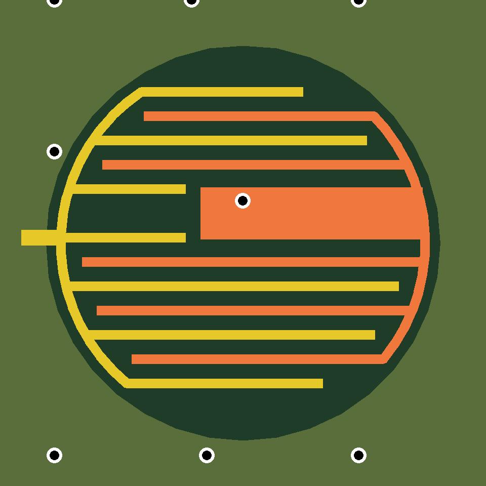

# eTutti StudentViaggio · v0.1 (14 nov 2026)

A **StudentViaggio** é a placa do **Viaggio J1** (`../viaggio_j1/`) com as 28 teclas de efeito Hall trocadas por **teclas resistivas**: um pente de cobre por tecla, sob uma folha sensível à pressão. Tudo o mais é a J1 como está: módulo SparkFun MicroMod Teensy no conector M.2, USB-C, carga, conversor de 3,3 V, codec, amplificador, encoders, LED.

Ela substitui o rascunho `student/` / `studentBK/` (v20), que não podia ser fabricado.

**Estado:** esquema e placa prontos e conferidos. **Não há ainda** arquivos de fabricação (Gerbers, BOM/CPL da JLC) nem firmware para as teclas resistivas. Nada foi construído.


## O que mudou em relação à J1

| | Viaggio J1 | StudentViaggio |
|---|---|---|
| Tecla | Gateron magnético + TMAG5253 no verso | pente de cobre no lado de cima (`FSR_Comb_D12`) |
| Peças por tecla | chave, sensor, capacitor | nenhuma (cobre da placa) |
| Alimentação dos sensores | 3 portas lógicas, grupos `EN_A`/`EN_B`, `SENS_EN` | não existe; o pino 4 do Teensy ficou livre |
| Referência da leitura | — | R601 e R602, 10 k ao 3,3 V no comum de cada mux |
| Footprints na placa | 178 | 120 (88 saíram, 30 entraram: 28 pentes, 2 resistores) |
| Placa de apoio das chaves (plate) | precisa | não precisa |
| Contorno, furos, camadas, regras | 246,5 × 95 mm, 4 camadas, 1,2 mm | iguais |

- As peças que saíram somam cerca de US$ 13 por placa na estimativa do `bom_preliminar.csv` da J1 (28 sensores a US$ 0,45, mais capacitores e portas). As 28 chaves Gateron e a plate, compradas à parte, também saem.
- Os canais dos multiplexadores são os da J1. A tabela está em `pcb/PINOS.md`.

## Como a tecla funciona



- **Amarelo = GND**, **laranja = sinal** (entrada do mux). Dedos de 0,3 mm, vão de 0,5 mm (mínimo 0,43 mm nas pontas), cobre exposto.
- Uma folha condutiva sensível à pressão fica sobre o pente. Apertar a folha liga os dedos com uma resistência que cai com a força.
- R601/R602 e a tecla formam um divisor: `V = 3,3 V × Rtecla / (Rtecla + 10 k)`. Solta = 3,3 V.
- **Velocidade:** a firmware mede quão depressa a tensão cai nos primeiros milissegundos do toque. A mesma leitura dá **pressão contínua depois da nota** (aftertouch por tecla), que as teclas Hall não davam.
- O bloco laranja no meio cobre a via de sinal que a J1 já trazia até o centro de cada tecla. Por isso as 28 rotas das teclas foram mantidas.
- O pente comum é o GND, não o 3,3 V: o que fica mais perto do dedo é o terra.

## Como a placa é feita

Dois scripts, nesta ordem, a partir da raiz do repositório:

```bash
python etutti/hardware/student_viaggio/pcb/schematic.py
```

```bash
"C:/Program Files/KiCad/10.0/bin/python.exe" etutti/hardware/student_viaggio/pcb/build_board.py
```

```bash
python etutti/hardware/student_viaggio/pcb/pinos.py
```

- `schematic.py` escreve o esquema (cópia do gerador do Viaggio MicroMod, folha T refeita), roda o ERC e compara a netlist com a da J1.
- `build_board.py` lê a placa da J1 **sem escrever nela**, tira o setor das teclas, põe os pentes e os dois resistores, e refaz só as ligações que cruzavam as teclas, com o roteador da J1 (`viaggio_j1/rota_restante.py`).
- `pinos.py` escreve o `pcb/PINOS.md`.

O projeto KiCad é `pcb/kicad/student_viaggio.kicad_pro`.

## Conferência (14 nov 2026)

| Verificação | Resultado |
|---|---|
| ERC do esquema | 0 erros, 0 avisos |
| Netlist × J1, fora do setor das teclas | igual |
| DRC do KiCad com as regras da J1 (`.kicad_dru`) | 0 violações |
| Ligações abertas | 0 |
| Paridade esquema × placa | 0 diferenças |
| Teclas ligadas a exatamente uma entrada de mux | 28 de 28 |
| Cobre alheio dentro dos pentes (raio 6,5 mm, lado de cima) | nenhum; só a via de sinal de cada tecla |
| Menor vão entre os dois eletrodos | 0,43 mm |

O que o `build_board.py` mexeu na J1:

- **Saíram:** 88 peças, as 192 trilhas e vias de `EN_A`/`EN_B`/`NS3`/`SENS_EN`, 10 trilhas do lado de cima e 195 vias que caíam dentro dos pentes (157 de GND, 35 de +3V3, 3 de sinal), mais os tocos que sobraram.
- **Refeitas pelo roteador:** `OUT_K03`, `OUT_K21`, `OUT_K23`, `OUT_K25`, `OUT_K28` e `MUX_S2` (passavam por cima de teclas), os dois comuns dos mux até os resistores novos, e 10 ligações de GND/+3V3. Nenhuma falha.
- **Vias novas:** K03 e K09 não tinham via no centro; ganharam uma.
- As 3 violações de largura que a J1 tinha eram da rede `EN_B`, que não existe mais.

Não conferido: nenhuma medida com a folha sensível real; alturas e mecânica (não há case nem botões para esta versão); flexão da placa sem a plate.

## Opções para as teclas resistivas

O pente da placa serve para as três primeiras. A escolha é do material que vai por cima.

| Opção | O que é | Custo (28 teclas) | Velocidade | Para quando |
|---|---|---|---|---|
| **A. Folha Velostat / Linqstat** (recomendada agora) | disco de 13 mm de filme condutivo, solto sobre o pente, com um anel adesivo fino como espaçador | uma folha, poucos dólares | pela subida da pressão; repetição entre teclas mediana, pede calibração por tecla | este protótipo |
| **B. Membrana FSR impressa** | uma folha de PET única, com 28 pontos de tinta FSR e espaçador, feita por fabricante de teclados de membrana | ferramental pequeno, depois barato por peça | a mesma medida, bem mais uniforme e estável | segunda rodada, se a A agradar ao toque |
| **C. Manta de silicone com pastilha de carbono** | botões de borracha moldados; com dois contatos em alturas diferentes mede o tempo entre eles, como teclados de sintetizador | molde caro, peça barata | a mais fiel, mas sem pressão contínua | produto final |
| **D. Toque capacitivo** | o mesmo cobre lido como capacitor, sem material nenhum | zero | não mede força | não atende ao objetivo |

Pontos a decidir ou medir com a opção A:

1. **Faixa da resistência.** Os 10 k de R601/R602 são um ponto de partida. Com a folha na mão, meça a resistência de uma tecla solta, tocada de leve e apertada, e ajuste o valor (são só dois resistores 0402).
2. **Espaçador.** Com o anel adesivo a tecla fica aberta sem toque e o limiar é nítido. Sem ele, a folha encosta sempre e a leitura deriva.
3. **O que o dedo toca.** A folha crua não é agradável nem durável. Um botão de silicone ou uma capa impressa por cima distribui a força.
4. **Acabamento.** Pedir **ENIG** (a J1 já pede): estanho (HASL) fica irregular e oxida no cobre exposto.

Antes de encomendar a placa inteira, vale um teste de bancada com um pente só (um recorte de placa ou uma placa de teste de 5 × 5 cm) e a folha escolhida.

## Opções para o uso do MicroMod

A placa hoje: conector M.2 Key E + módulo SparkFun MicroMod Teensy (DEV-16402), o mesmo da J1.

| Opção | O que muda | Ganho | Custo |
|---|---|---|---|
| **1. Como está** | nada | pronto; firmware `teensy:avr:teensyMM`; módulo reaproveitado entre placas | módulo de ~US$ 25 por instrumento |
| **2. Cartão próprio no formato MicroMod** | um cartão de 22 × 22 mm com o RT1062 em BGA, desenhado por nós, encaixado no mesmo M.2 | o passo para o BGA acontece num cartão pequeno e barato de repetir, sem tocar na placa das teclas; foi o roteamento do BGA que travou o Viaggio v2.1 | um projeto novo, de 6 camadas, com o bootloader da PJRC |
| **3. Outro processador MicroMod** | trocar o cartão (RP2040, ESP32, STM32) | cartões de US$ 10–15 para versões de estudo | firmware e áudio refeitos; só os pinos padrão do MicroMod coincidem |
| **4. Placa de 2 camadas para a Student** | sem BGA e sem sensores, o roteamento é simples o bastante para tentar 2 camadas | PCB mais barato | roteamento refeito do zero; perde o plano de GND inteiro sob os pentes |

- **Recomendação:** ficar na opção 1 para este protótipo e tratar a 2 como o caminho para o BGA. O esquema do cartão da SparkFun é aberto e o `MM_PADS` do `schematic.py` já tem a ligação pad a pad.
- O que ajuda a trocar de cartão: os sinais de áudio, I2C e as duas entradas analógicas dos mux já estão nos pads padrão do MicroMod (`AUD_*`, `I2C_*`, `A0`, `A1`). Os demais (endereço dos mux, encoders, LED, liga/desliga) usam pads que mudam de função entre processadores.

## Próximos passos

1. **O J escolhe** a opção das teclas e confirma o MicroMod.
2. Teste de bancada de um pente com a folha.
3. Firmware das teclas resistivas (agente `programacao-som`): varredura, limiar, velocidade pela subida, aftertouch.
4. Arquivos de fabricação (Gerbers, BOM/CPL), com a conferência de alturas sem a plate.

## Perguntas para a gestão

1. A Student entra no protocolo com SPEC própria, ou segue como variante da SPEC do Viaggio MicroMod?
2. O miolo de sinal (bloco laranja) tira área sensível do lado direito do pente. Aceitável no protótipo, ou vale mover as 28 vias para um miolo menor?
3. Haverá botão sobre a folha nesta versão? Disso dependem a altura e o case.
4. As pastas `student/` e `studentBK/` (v20, fora do Git) podem ser apagadas?
