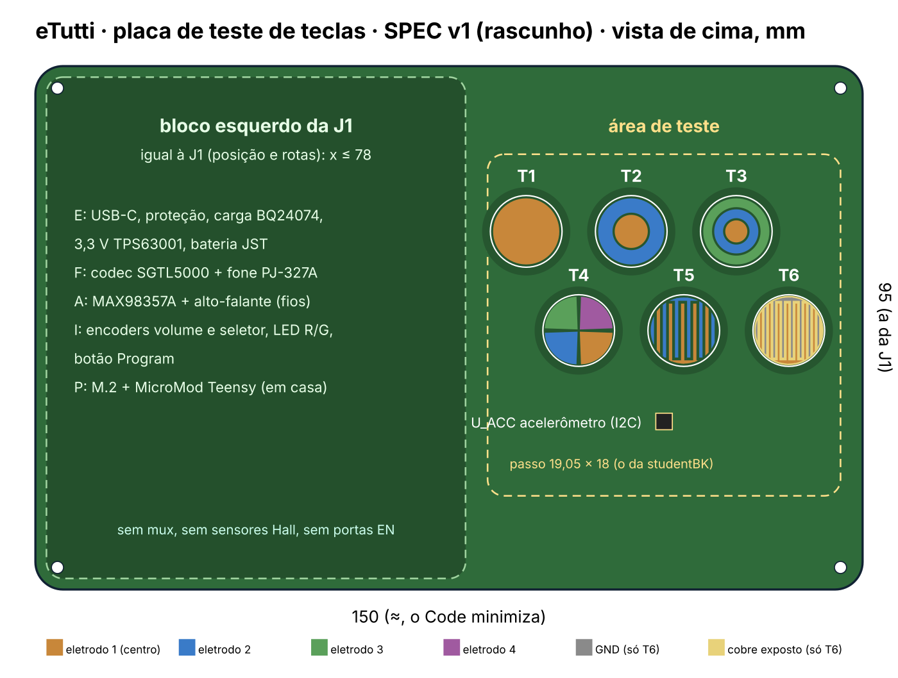
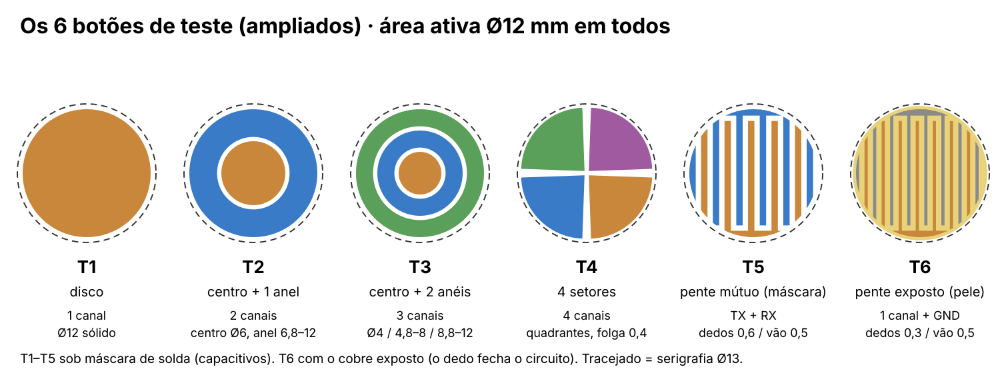

# eTutti · placa de teste de teclas · especificação · v1 (rascunho para acordo)

**Versão 1, 14 nov 2026.** Mantida pela gestão (Claude Chat com o J); o Code não edita este arquivo. Mesmo protocolo do Viaggio (`CLAUDE.md`, "como trabalhamos"): cada disciplina responde no seu relatório, terminando com "Perguntas para a gestão".

Medidas em mm. **(conferir)** = estimativa a confirmar com a peça real ou o datasheet.

**Estado: rascunho.** O J aprova esta versão antes de o Code começar. Nada se encomenda sem o J.

## Mudanças desde a versão anterior

- Primeira versão.

## 0. Para que serve

A **StudentViaggio** terá teclas feitas só com o cobre da placa: sem chave, sem sensor por tecla, sem silicone, sem membrana, sem folha sensível. A placa chega montada da JLC e já funciona (decisão do J, 14 nov 2026). O eTutti padrão continua com as teclas Hall.

Esta placa de teste compara **seis formas de tecla de cobre**, um botão de cada, para escolher a que dá a melhor **velocidade** (e, se der, pressão). Ela já usa a eletrônica da versão final: **o bloco esquerdo da Viaggio J1**, com o módulo MicroMod Teensy e o áudio integrado (codec e amplificador).

Plano em três etapas (do J):
1. **Desenho** desta placa: esta SPEC.
2. **Arquivos para o pedido** (Code, eletrônica): esquema, placa, Gerbers, BOM/CPL.
3. **Firmware e testes** (Code, programação e som), um algoritmo por tipo de tecla, que leva em conta a geometria de cada uma (§4); depois a comparação.

## 1. Decisões

| Item | Decisão |
|---|---|
| Eletrônica | **Bloco esquerdo da J1** (`viaggio_j1/`, x ≤ 78), com as mesmas posições e rotas: E (USB-C, proteção, BQ24074, TPS63001, bateria JST com NTC), F (SGTL5000 + fone PJ-327A), A (MAX98357A + alto-falante por fios), I (encoders de volume e seletor, LED R/G, botão Program), P (M.2 + espaçador + MicroMod Teensy, encaixado em casa). |
| Sai da J1 | Setor T inteiro: os 2 mux, os 28 TMAG5253, as portas EN, os capacitores das teclas e as rotas `OUT_Kxx`, `MUX_*`, `EN_*` e `SENS_EN`. |
| Placa | Retângulo de cerca de **150 × 95** (a altura é a da J1; o Code reduz a largura o quanto der), cantos R 5, **4 camadas, 1,2 mm, JLC04121H-7628** (a da J1, para não mexer no bloco já roteado), **ENIG**, máscara verde (montagem Economic de 4 camadas), vias 0,5 / 0,3. |
| Montagem | Só no **lado de cima** (Economic). Se a J1 tiver peça embaixo no bloco esquerdo (o M.2 está no verso), o Code diz no relatório se ela vai para cima ou se a montagem passa a Standard, e quanto custa cada caminho. |
| Botões | 6, numa grade de **19,05 × 18** (o passo da `studentBK`): fileira de cima T1 T2 T3, de baixo T4 T5 T6, deslocada meio passo. **Área ativa Ø12** em todos; serigrafia de um círculo Ø13 e o nome (T1…T6). |
| Velocidade pela placa | Um **acelerômetro MEMS** de 3 eixos (U_ACC) no centro da área de teste, no I2C, com a interrupção num pino livre. |
| Modo de teste | O **seletor** escolhe qual botão e qual algoritmo estão ativos; o LED mostra o estado. Detalhe na etapa 3. |
| Pés | 4 furos (os M2 que a J1 já tem no bloco esquerdo e 2 novos nos cantos da direita), para pés de borracha ou espaçadores. A bateria vai embaixo da placa, presa por fita. |

## 2. Planta

Origem no canto de cima à esquerda, x para a direita, y para baixo (o sistema da J1).

| Peça | Centro (x; y) |
|---|---|
| T1 | (89,0; 30,0) |
| T2 | (108,05; 30,0) |
| T3 | (127,1; 30,0) |
| T4 | (98,525; 48,0) |
| T5 | (117,575; 48,0) |
| T6 | (136,625; 48,0) |
| U_ACC | perto de (114; 65), a 7 mm ou mais de qualquer eletrodo **(conferir)** |

O Code pode deslocar o grupo inteiro (sem mudar as distâncias entre os botões) para encurtar a placa ou as trilhas.

## 3. Os seis botões

| Botão | Forma | Canais | Medidas | Como é lido | O que testa |
|---|---|---|---|---|---|
| **T1** | disco | 1 | Ø12 sólido | capacitância própria | a curva da área de contato: velocidade pela subida, pressão pelo valor final. É a referência. |
| **T2** | centro + 1 anel | 2 | centro Ø6; anel Ø6,8–12 | capacitância própria, 2 canais | o tempo entre o centro e o anel = velocidade, como as duas chaves de um teclado de sintetizador. |
| **T3** | centro + 2 anéis | 3 | Ø4; Ø4,8–8; Ø8,8–12 | capacitância própria, 3 canais | o mesmo com 3 tempos: mais resolução, e 2 medidas por toque. |
| **T4** | 4 setores | 4 | quadrantes de Ø12, folga 0,4 | capacitância própria, 4 canais | onde o dedo cai e para que lado se espalha; a soma dos 4 é igual ao T1. Mostra se o dedo fora do centro estraga a leitura. |
| **T5** | pente, mútuo | 2 | dedos 0,6, vão 0,5 **(conferir)** | capacitância mútua: um pente emite (TX), o outro recebe (RX); o dedo rouba campo | a medida mútua costuma ter menos ruído e não depende do aterramento de quem toca. |
| **T6** | pente, cobre exposto | 1 + GND | dedos 0,3, vão 0,5 (o `FSR_Comb_D12`) | resistiva: o dedo liga os dois pentes; a condutância sobe com a área | a medida sem capacitância, só para comparar; depende da umidade da pele. |

Regras dos eletrodos:
- **T1–T5 sob máscara de solda**, sem abertura. **T6 com a máscara aberta** (cobre ENIG exposto).
- Cada eletrodo desce por **uma via no próprio cobre** (tampada pela máscara nos T1–T5) e segue numa camada interna ou no verso. Os anéis são fechados (sem fenda).
- Embaixo de cada botão, num **círculo Ø16**: nada de cobre em In1, In2 e verso, a não ser a via de descida. Entre os botões e em volta deles, **GND hachurado** no verso (cerca de 25 % de cobre, **conferir**). O ambiente dos 6 botões tem de ser **igual**, para a comparação ser justa.
- Trilhas dos eletrodos: 0,15 mm, as mais curtas possível, a 1 mm ou mais umas das outras e de qualquer sinal que muda (I2S, encoders, LED). Nada de trilha de outra rede passando sob a área de teste.
- Um **ponto de teste** (pad Ø1,0 no verso) em cada linha de eletrodo, para o osciloscópio.

## 4. Ligação ao Teensy

Sem mux: cada linha vai direto a um pino. Os pinos livres na J1 sem o setor T são 0–4, 8, 14 (A0), 15 (A1), 27 e 29–45 (ver `viaggio_micromod/pcb/PINOS.md`). A tabela final é do Code (eletrônica), num `pcb/PINOS.md` desta pasta.

| Linha | Quantas | Pino | Peças na placa |
|---|---|---|---|
| Eletrodos de capacitância própria (T1, T2×2, T3×3, T4×4) | 10 | pinos digitais livres; **se der, todos na mesma porta GPIO do RT1062** (a firmware lê os 10 de uma vez) | por linha: R_S 0402 em série (0 Ω de fábrica; lugar para 470 Ω) e R_C 0402 de **1 MΩ** (conferir) até a rede comum `CAP_SEND` |
| `CAP_SEND` | 1 | pino digital | — |
| T5 TX | 1 | pino digital | 100 Ω em série |
| T5 RX | 1 | **14 (A0)** | lugar para um capacitor 0402 ao GND, **não montado** |
| T6 | 1 | **15 (A1)** | 1 MΩ ao 3,3 V (conferir), 1 kΩ em série e um TVS de ESD ao GND (o cobre é exposto) |
| U_ACC SDA/SCL | — | 18 / 19 (o I2C do SGTL5000, endereço 0x0A) | o endereço do acelerômetro não pode ser 0x0A |
| U_ACC INT1 | 1 | pino digital livre | — |

Com R_C montado, a leitura é pelo tempo de carga RC (a firmware mede em ciclos de CPU). Sem R_C, cabe a transferência de carga pelo próprio pino. O lugar para as duas formas fica na placa; a firmware escolhe.

**Acelerômetro:** 3 eixos, I2C, **taxa de 1 kHz ou mais**, na JLC (de preferência peça básica ou estendida preferida). O Code escolhe e diz qual.

## 5. Contrato com a etapa 3

O Code (eletrônica) entrega `pcb/ELETRODOS.md`, que a firmware usa para "considerar o aspecto físico" de cada botão:
- por eletrodo: área (mm²), perímetro, raio interno e externo, comprimento e camada da trilha, pino, R_S e R_C montados;
- a capacitância parasita estimada de cada linha **(conferir)**;
- a distância de cada botão ao U_ACC.

## 6. Custo (estimativa, a cotar)

- Placa de 4 camadas, cerca de 150 × 95, 5 unidades, 2 montadas (Economic). As peças do bloco esquerdo têm os preços do BOM da J1; mais o acelerômetro e cerca de 25 resistores 0402.
- Ordem de grandeza: **£110–150** com frete e IVA, sem o módulo MicroMod. O relatório do Code traz a cotação real da JLC.

## Tarefas para o Code (v1), depois de o J aprovar

**Eletrônica** (pasta `etutti/hardware/teste_teclas/`; relatório `ELETRONICA.md`):
1. Esquema: o da J1 sem o setor T, mais um setor novo (6 botões, U_ACC, resistores, TVS, pontos de teste). ERC 0/0. Netlist do bloco esquerdo igual à da J1.
2. Footprints dos 6 eletrodos (§3), gerados por script, com as medidas da tabela.
3. Placa: o bloco esquerdo copiado da J1 com as posições e rotas; área de teste conforme §2–§3; contorno, furos, regras. **O J roteia a área de teste** no KiCad, se preferir (decisão de 25 out 2026: o Code não roteia). Se o J quiser que o Code roteie só esta área, ele diz na aprovação.
4. `pcb/PINOS.md` (§4) e `pcb/ELETRODOS.md` (§5).
5. Depois do roteamento: DRC 0, paridade 0, Gerbers, BOM/CPL, cotação real da JLC. **Não encomendar.**

**Programação e som** (só depois da placa; entra na v2 desta SPEC, com o detalhe da etapa 3):
- leitura dos 3 tipos (própria, mútua, resistiva) e do acelerômetro, com fluxo de dados crus pela USB para registrar as curvas;
- um algoritmo de velocidade por botão, com os parâmetros do `ELETRODOS.md`;
- o mesmo motor de som da Viaggio, para tocar com cada botão.

## 7. Perguntas para o J

1. Os **6 tipos** estão bons? Algum sai, ou algum entra (por exemplo, um segundo T3 com outro diâmetro)?
2. **Bateria:** fica (é a eletrônica final, e o teste mostra o ruído com e sem USB) ou sai, para baratear?
3. **Roteamento da área de teste:** você roteia (como na J1), ou o Code roteia só esta área?
4. O **acelerômetro** entra? Ele custa pouco e é a única medida de força que não depende da pele.
