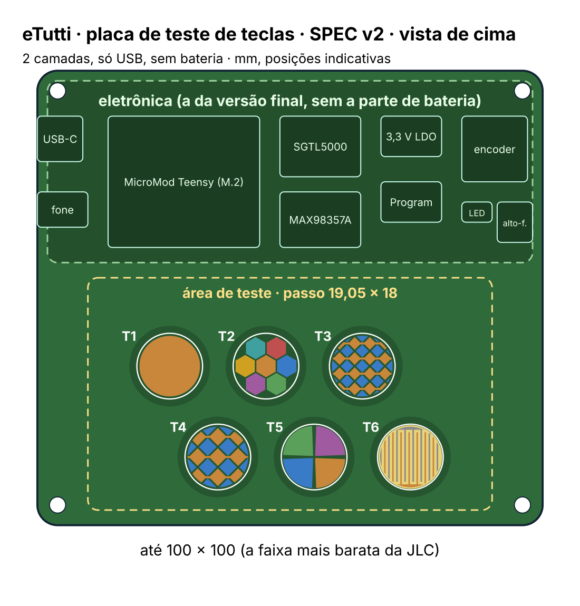
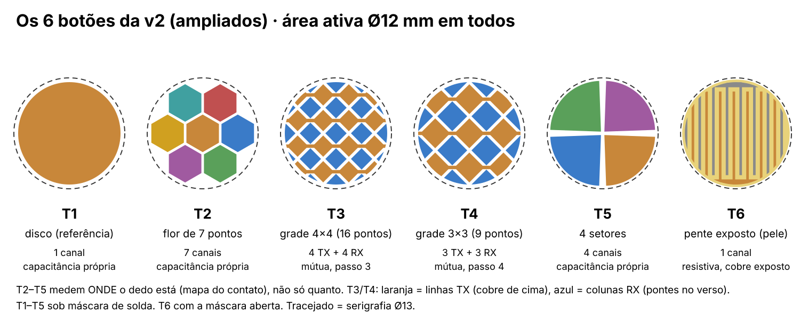

# eTutti · placa de teste de teclas · especificação · v2

**Versão 2, 14 nov 2026.** Mantida pela gestão (Claude Chat com o J); o Code não edita este arquivo. Mesmo protocolo do Viaggio (`CLAUDE.md`, "como trabalhamos"): cada disciplina responde no seu relatório, terminando com "Perguntas para a gestão".

Medidas em mm. **(conferir)** = estimativa a confirmar com a peça real ou o datasheet.

## Mudanças desde a versão anterior

### v2 (respostas do J à v1, 14 nov 2026)

- **Sem acelerômetro.** A tecla tem de responder a um toque leve do dedo; força medida pela placa não serve.
- **2 camadas**, no limite do orçamento baixo (§6). A placa não copia mais o bloco roteado da J1: o Code redesenha e **roteia** a placa inteira (decisão do J para esta placa; a regra "o J roteia" continua valendo para a Viaggio).
- **Sem bateria: só USB.** Saem o BQ24074, o TPS63001, o indutor, o conector JST e a lógica de liga/desliga. Entra um regulador linear de 3,3 V.
- **Botões que mapeiam o contato inteiro.** O J lembra que o dedo nem sempre aperta do centro para fora. Saem os anéis (T2 e T3 da v1, que supõem o toque no centro) e entram três botões de **vários pontos**: a flor de 7 pontos e duas grades mútuas (§3).
- Um encoder só (volume e modo de teste); LED em duas peças 0603 comuns.

### v1

- Primeira versão (rascunho, PR #132).

## 0. Para que serve

A **StudentViaggio** terá teclas feitas só com o cobre da placa: sem chave, sem sensor por tecla, sem silicone, sem membrana, sem folha sensível. A placa chega montada da JLC e já funciona (decisão do J, 14 nov 2026). O eTutti padrão continua com as teclas Hall.

Esta placa compara **seis formas de tecla de cobre**, um botão de cada, para escolher a que dá a melhor **velocidade com um toque leve, em qualquer ponto do botão**. A eletrônica é a da versão final: módulo **MicroMod Teensy** e **áudio integrado** (SGTL5000 com fone, MAX98357A com alto-falante).

Plano do J:
1. **Desenho**: esta SPEC.
2. **Arquivos para o pedido** (Code, eletrônica): esquema, placa roteada, Gerbers, BOM/CPL, cotação.
3. **Firmware e testes** (Code, programação e som): um algoritmo por botão, que usa a geometria de cada um (§5), e a comparação.

## 1. Decisões

| Item | Decisão |
|---|---|
| Placa | **2 camadas, 1,6 mm**, até **100 × 100** (a faixa mais barata da JLC), cantos R 4, HASL sem chumbo, máscara verde. O Code diz na cotação quanto o ENIG custaria a mais (só o T6 tem cobre exposto). |
| Montagem | JLC **Economic, só o lado de cima**, 2 placas montadas de 5. Peças básicas sempre que der; cada peça estendida custa US$ 3,07 de carga. |
| Processador | Conector **M.2 Key E** da J1 (UMAX 91302-42-067) no lado de cima. O módulo é preso por **parafuso M2.5 e porca**, num furo (sem o espaçador SMD da J1, que exigia compra global). O J encaixa o módulo em casa. |
| Alimentação | **Só USB-C** (resistores 5,1 k no CC, USBLC6 na linha de dados). 5 V da USB para o MAX98357A; um **LDO de 3,3 V** (peça básica, 500 mA ou mais) para o módulo e o SGTL5000. Ligar o cabo = ligar a placa. |
| Áudio | O da J1 (setores F e A): SGTL5000 + regulador de 1,8 V + fone PJ-327A (manga no HP_VGND, nunca no GND); MAX98357A com o alto-falante por fios, em dois pads. |
| Interface | **1 encoder** EC11E com clique (girar = volume; clique = próximo botão/algoritmo em teste), **LED verde e vermelho** (0603, peças básicas), botão Program. |
| Botões | 6, na grade **19,05 × 18** (o passo da `studentBK`): T1 T2 T3 em cima, T4 T5 T6 embaixo, meio passo deslocados. **Área ativa Ø12** em todos; serigrafia de um círculo Ø13 e o nome. |
| Pés | 4 furos M3 nos cantos, para pés de borracha. |

## 2. Planta

A eletrônica numa faixa de cima (cerca de 36 de altura), a área de teste embaixo, longe do USB, do áudio e do encoder. O desenho é indicativo: o Code acomoda as peças. Regras que valem:
- USB-C e fone na borda esquerda; encoder e LED na direita; o alto-falante fica fora da placa (fios).
- Nenhuma trilha de I2S, MCLK, encoder ou LED a menos de **5 mm** de um botão.
- Os 6 botões ficam juntos, no mesmo ambiente (§3), para a comparação ser justa.

## 3. Os seis botões

| Botão | Forma | Linhas | Medidas | Leitura | O que testa |
|---|---|---|---|---|---|
| **T1** | disco | 1 | Ø12 sólido | capacitância própria | a referência: só "quanto" contato, sem "onde". |
| **T2** | **flor de 7 pontos** | 7 | 7 hexágonos, raio 2,2, folga 0,3 | capacitância própria, 7 canais | o mapa mais simples: cada ponto tem o seu fio. |
| **T3** | **grade mútua 4×4** | 4 TX + 4 RX | losangos, passo 3,0, folga 0,25 | capacitância mútua: 16 cruzamentos | o mapa fino, como numa tela de toque. |
| **T4** | **grade mútua 3×3** | 3 TX + 3 RX | losangos, passo 4,0 | capacitância mútua: 9 cruzamentos | se uma grade mais grossa (menos fios) basta. |
| **T5** | 4 setores | 4 | quadrantes de Ø12, folga 0,4 | capacitância própria, 4 canais | o mapa mais grosso. |
| **T6** | pente exposto | 1 + GND | dedos 0,3, vão 0,5 (o `FSR_Comb_D12`) | resistiva: o dedo liga os dois pentes | sem capacitância, para comparar; depende da pele. |

**Por que vários pontos funcionam com o toque fora do centro.** Em cada leitura a firmware tem um pequeno mapa do botão. Ela soma o contato de **todos** os pontos (a área total) e acha o centro do dedo. A velocidade sai da rapidez com que a **área total** cresce, venha o dedo de onde vier. O mapa também mostra um dedo que escorrega ou que pega dois botões.

Regras dos eletrodos:
- **T1–T5 sob máscara de solda**, sem abertura. **T6 com a máscara aberta.**
- Os pontos da flor (T2), os setores (T5) e o disco (T1) descem por **uma via tampada no próprio cobre** e seguem no verso.
- Grades (T3, T4): as linhas TX ficam ligadas no cobre de cima, por pescoços de 0,4; as colunas RX são ligadas por **pontes no verso**, uma via em cada losango.
- Sob cada botão, num **círculo Ø16**, o verso só tem as descidas e as pontes do próprio botão. Em volta dos botões, **GND hachurado** no verso (cerca de 25 % de cobre, **conferir**). O ambiente dos 6 é igual.
- Trilhas dos eletrodos: 0,15, as mais curtas possível, a 1 ou mais umas das outras. **Ponto de teste** (pad Ø1,0 no verso) em cada linha.

## 4. Ligação ao Teensy

Sem multiplexador: cada linha vai direto a um pino. As 25 linhas cabem nos pinos do MicroMod (0–45 saem no conector; sem a bateria e com um encoder só, sobram mais pinos que na J1). A tabela final é do Code, no `pcb/PINOS.md` desta pasta.

| Linhas | Quantas | Pinos | Peças por linha |
|---|---|---|---|
| Capacitância própria (T1 1, T2 7, T5 4) | 12 | digitais; **se der, na mesma porta GPIO do RT1062** (lidas de uma vez) | R_S 0402 em série (0 Ω; lugar para 470 Ω) e R_C 0402 de **1 MΩ** (conferir) até `CAP_SEND` |
| `CAP_SEND` | 1 | digital | — |
| TX das grades | 4 | digitais; **T3 e T4 dividem as mesmas 4 linhas** (o T4 usa 3) | 100 Ω em série |
| RX das grades (T3 4, T4 3) | 7 | **analógicos** (14, 15, 16, 26, 27, 38–41: conferir quais saem no MicroMod) | lugar para um capacitor 0402 ao GND, não montado |
| T6 | 1 | analógico | 1 MΩ ao 3,3 V (conferir), 1 kΩ em série, TVS de ESD ao GND |

Se faltar pino analógico, o RX das grades pode ser lido por tempo de carga num pino digital (o Code diz no relatório).

**Para o produto (não para esta placa):** 28 teclas com 7 a 16 pontos cada dão 200 a 450 pontos, e isso não cabe em pinos soltos. O teclado inteiro viraria uma **grade única**, como numa tela de toque: linhas e colunas compartilhadas entre as teclas, lidas por um chip controlador de toque. Esta placa diz **quantos pontos por tecla são precisos** antes de escolher o chip.

## 5. Contrato com a etapa 3

O Code (eletrônica) entrega `pcb/ELETRODOS.md`, que a firmware usa para considerar a forma de cada botão:
- por eletrodo ou cruzamento: **coordenadas do centro** em relação ao centro do botão, área (mm²), pino, R_S e R_C montados;
- comprimento e camada de cada trilha, e a capacitância parasita estimada **(conferir)**.

## 6. Custo (estimativa; o Code traz a cotação real)

| Item | US$ |
|---|---|
| Placa 2 camadas, até 100 × 100, 5 unidades | 2–5 |
| Montagem Economic: preparação + estêncil | ~10 |
| Carga das peças estendidas: cerca de 9 tipos (M.2, USB-C, SGTL5000, regulador de 1,8 V, MAX98357A, fone, TVS, 2 passivos) × 3,07 | ~28 |
| Solda manual do encoder (furo passante) | 3,50 |
| Peças para 2 placas (cerca de US$ 7 cada) | ~14 |
| Frete para o Reino Unido + IVA de 20 % | ~30 |
| **Total JLC** | **~85–95 (cerca de £ 70–75)** |
| Em casa: alto-falante, parafuso e porca M2.5, 4 pés | £ 5–8 |

Sem o módulo MicroMod (£ 24, se for preciso comprar). **Risco:** se a JLC não aceitar o SGTL5000 (QFN de 0,4 mm) na montagem Economic, a placa passa para a Standard e o total sobe cerca de £ 30.

## Tarefas para o Code (v2)

**Eletrônica** (pasta `etutti/hardware/teste_teclas/`; relatório `ELETRONICA.md`):
1. Esquema novo de 2 camadas: os setores F e A da J1 como estão; P com o M.2 e o furo do parafuso; alimentação só por USB (§1); 1 encoder, 2 LEDs, Program; o setor dos 6 botões (§3, §4). ERC 0/0. Netlist dos setores F e A igual à da J1.
2. Footprints dos 6 eletrodos, gerados por script, com as medidas do §3.
3. Placa: contorno até 100 × 100, furos, regras (as mínimas da JLC para 2 camadas, com folga), posição (§2). **O Code roteia a placa inteira.** DRC 0, paridade 0.
4. `pcb/PINOS.md` (§4) e `pcb/ELETRODOS.md` (§5).
5. Gerbers, BOM/CPL e a **cotação real da JLC**: Economic; ENIG como opção; se o SGTL5000 obrigar a Standard, as duas cotações. **Não encomendar.**

**Programação e som:** nada nesta versão. A etapa 3 entra numa versão seguinte, depois da placa: leitura dos três tipos, fluxo de dados crus pela USB, um algoritmo por botão usando o `ELETRODOS.md`, e o som da Viaggio para tocar.

## 7. Perguntas para o J

Nenhuma aberta. A v2 está pronta para o Code.
