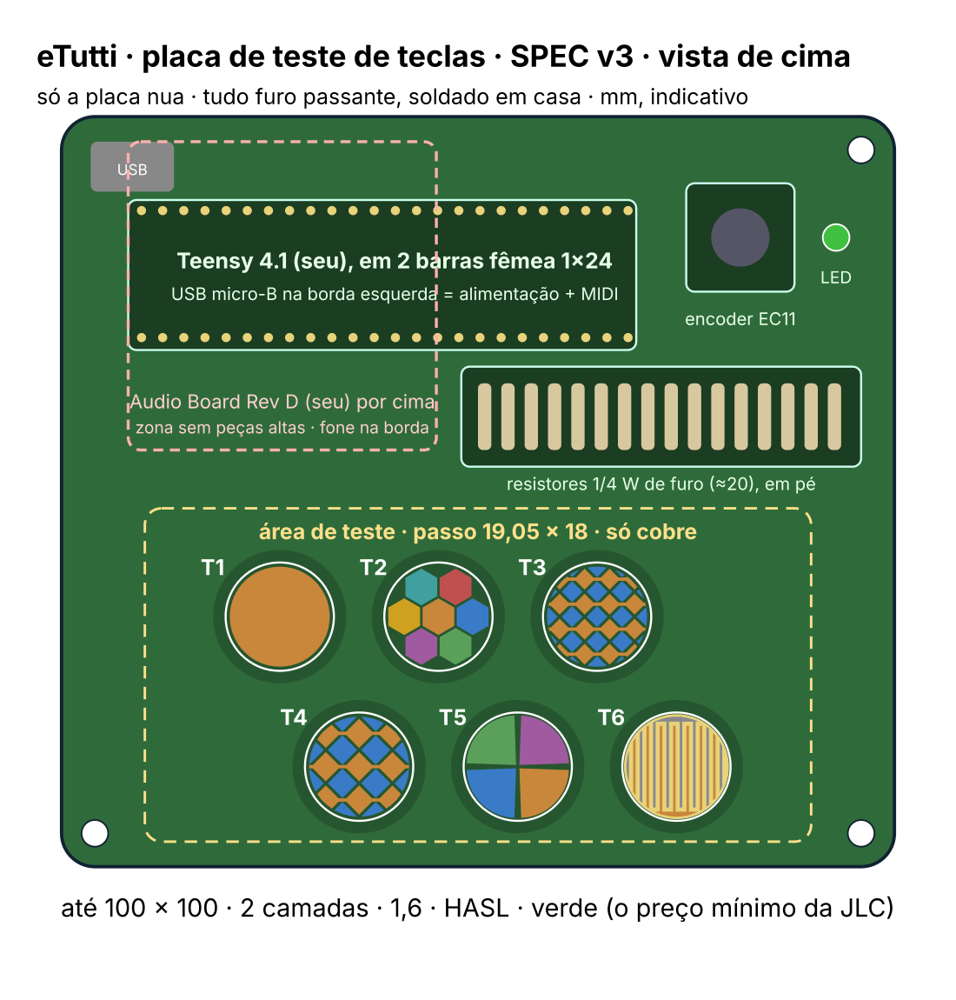

# eTutti · placa de teste de teclas · especificação · v3

**Versão 3, 14 nov 2026.** Mantida pela gestão (Claude Chat com o J); o Code não edita este arquivo. Mesmo protocolo do Viaggio (`CLAUDE.md`, "como trabalhamos"): cada disciplina responde no seu relatório, terminando com "Perguntas para a gestão".

Medidas em mm. **(conferir)** = estimativa a confirmar com a peça real ou o datasheet.

## Mudanças desde a versão anterior

### v3 (o J recusou o orçamento da v2, 14 nov 2026)

- **Só a placa nua.** A JLC não monta nada; o J solda tudo em casa.
- **Só peças de furo passante.** Nenhuma peça SMD.
- **Usa o Teensy 4.1 e o Audio Board Rev D que o J já tem**, encaixados em barras fêmea. Saem o M.2, o MicroMod, o SGTL5000 e o MAX98357A da placa, o USB-C e o regulador. A placa é alimentada pelo micro-USB do Teensy.
- **Sem alto-falante na placa:** o som sai pelo fone do Audio Board (fone ou caixa amplificada).
- Os 6 botões da v2 continuam iguais (§3).

### v2 (respostas do J à v1, 14 nov 2026)

- **Sem acelerômetro.** A tecla tem de responder a um toque leve do dedo; força medida pela placa não serve.
- **2 camadas**, no limite do orçamento baixo (§6). A placa não copia mais o bloco roteado da J1: o Code redesenha e **roteia** a placa inteira (decisão do J para esta placa; a regra "o J roteia" continua valendo para a Viaggio).
- **Sem bateria: só USB.** Saem o BQ24074, o TPS63001, o indutor, o conector JST e a lógica de liga/desliga. Entra um regulador linear de 3,3 V.
- **Botões que mapeiam o contato inteiro.** O J lembra que o dedo nem sempre aperta do centro para fora. Saem os anéis (T2 e T3 da v1, que supõem o toque no centro) e entram três botões de **vários pontos**: a flor de 7 pontos e duas grades mútuas (§3).
- Um encoder só (volume e modo de teste); LED em duas peças 0603 comuns.

### v1

- Primeira versão (rascunho, PR #132).

## 0. Para que serve

A **StudentViaggio** terá teclas feitas só com o cobre da placa (decisão do J, 14 nov 2026). Esta placa compara **seis formas de tecla de cobre**, um botão de cada, para escolher a que dá a melhor **velocidade com um toque leve, em qualquer ponto do botão**. É a versão mais barata possível: uma placa nua de 2 camadas, peças de furo soldadas em casa, e o Teensy 4.1 e o Audio Board que o J já tem.

O que se mede aqui vale para o produto: o MicroMod Teensy usa o mesmo processador (RT1062) que o Teensy 4.1, e a firmware dos botões passa de um para o outro mudando só o mapa de pinos.

Plano do J:
1. **Desenho**: esta SPEC.
2. **Arquivos para o pedido** (Code, eletrônica): esquema, placa roteada pelo Code, Gerbers.
3. **Firmware e testes** (Code, programação e som): um algoritmo por botão, que usa a geometria de cada um (§5), e a comparação.

## 1. Decisões

| Item | Decisão |
|---|---|
| Placa | **2 camadas, 1,6 mm, até 100 × 100, HASL, máscara verde**: as opções que custam o preço mínimo da JLC. Nada que mude o preço (cor, ENIG, borda especial, furo escareado). Cantos R 4. |
| Montagem | **Nenhuma na JLC.** Só peças de furo passante, soldadas pelo J. |
| Processador | **Teensy 4.1 do J**, em **2 barras fêmea 1×24** (passo 2,54, fileiras a 15,24). O micro-USB do Teensy fica na borda esquerda da placa: alimentação e MIDI. |
| Áudio | **Audio Board Rev D do J**, empilhado sobre o Teensy como de costume (no 4.1, ele fica na ponta do USB). Na placa, uma **zona de cerca de 37 × 37 sem peças altas** embaixo dele, e o fone dele virado para a borda. |
| Interface | **Encoder EC11 com clique**, de furo (girar = volume; clique = próximo botão/algoritmo em teste); **1 LED de 3 mm** com resistor. Sem botão Program (o Teensy tem o dele). |
| Resistores | **1/4 W de furo**, montados em pé, numa faixa ao lado do Teensy, longe dos botões. |
| Botões | Os 6 da v2 (§3), na grade **19,05 × 18**: T1 T2 T3 em cima, T4 T5 T6 embaixo. **Área ativa Ø12**; serigrafia de um círculo Ø13 e o nome. |
| Pés | 3 ou 4 furos M3 nos cantos livres, para pés de borracha. |

## 2. Planta

Teensy e Audio Board em cima à esquerda; encoder, LED e resistores em cima à direita; a área de teste embaixo, longe do Teensy e do áudio. O desenho é indicativo: o Code acomoda as peças. Regras que valem:
- Nenhuma trilha de I2S, MCLK, encoder ou LED a menos de **5 mm** de um botão.
- Os 6 botões ficam juntos, no mesmo ambiente (§3), para a comparação ser justa.
- Os resistores ficam numa faixa só, perto do Teensy. As trilhas dos eletrodos vão dos resistores aos botões, curtas e afastadas umas das outras.

## 3. Os seis botões

| Botão | Forma | Linhas | Medidas | Leitura | O que testa |
|---|---|---|---|---|---|
| **T1** | disco | 1 | Ø12 sólido | capacitância própria | a referência: só "quanto" contato, sem "onde". |
| **T2** | **flor de 7 pontos** | 7 | 7 hexágonos, raio 2,2, folga 0,3 | capacitância própria, 7 canais | o mapa mais simples: cada ponto tem o seu fio. |
| **T3** | **grade mútua 4×4** | 4 TX + 4 RX | losangos, passo 3,0, folga 0,25 | capacitância mútua: 16 cruzamentos | o mapa fino, como numa tela de toque. |
| **T4** | **grade mútua 3×3** | 3 TX + 3 RX | losangos, passo 4,0 | capacitância mútua: 9 cruzamentos | se uma grade mais grossa (menos fios) basta. |
| **T5** | 4 setores | 4 | quadrantes de Ø12, folga 0,4 | capacitância própria, 4 canais | o mapa mais grosso. |
| **T6** | pente exposto | 1 + GND | dedos 0,3, vão 0,5 (o `FSR_Comb_D12`) | resistiva: o dedo liga os dois pentes | sem capacitância, para comparar; depende da pele. |

**Por que vários pontos funcionam com o toque fora do centro.** Em cada leitura a firmware tem um pequeno mapa do botão. Ela soma o contato de **todos** os pontos (a área total) e acha o centro do dedo. A velocidade sai da rapidez com que a **área total** cresce, venha o dedo de onde vier. O mapa também mostra um dedo que escorrega ou que pega dois botões.

Regras dos eletrodos:
- **T1–T5 sob máscara de solda**, sem abertura. **T6 com a máscara aberta.**
- Os pontos da flor (T2), os setores (T5) e o disco (T1) descem por **uma via tampada no próprio cobre** e seguem no verso. Vias e pontes não custam nada a mais numa placa nua.
- Grades (T3, T4): as linhas TX ficam ligadas no cobre de cima, por pescoços de 0,4; as colunas RX são ligadas por **pontes no verso**, uma via em cada losango.
- Sob cada botão, num **círculo Ø16**, o verso só tem as descidas e as pontes do próprio botão. Em volta dos botões, **GND hachurado** no verso (cerca de 25 % de cobre, **conferir**). O ambiente dos 6 é igual.
- Trilhas dos eletrodos: 0,15, as mais curtas possível, a 1 ou mais umas das outras. Os terminais dos resistores servem de ponto de teste para o osciloscópio.

## 4. Ligação ao Teensy 4.1

Sem multiplexador: cada linha vai direto a um pino. O Audio Board usa os pinos 7, 8, 20, 21, 23 (áudio), 18, 19 (I2C), 15 (potenciômetro opcional) e 6, 10–13 (cartão SD e memória). **Sobram 29 pinos**: 0–5, 9, 14, 16, 17, 22 e 24–41. A placa precisa de **exatamente 29**:

| Linhas | Quantas | Pinos | Peças por linha |
|---|---|---|---|
| Capacitância própria (T1 1, T2 7, T5 4) | 12 | digitais; **se der, na mesma porta GPIO do RT1062** (lidas de uma vez) | 1 MΩ até `CAP_SEND` |
| `CAP_SEND` | 1 | digital | — |
| TX das grades | 4 | digitais; **T3 e T4 dividem as mesmas 4 linhas** (o T4 usa 3) | 100 Ω em série |
| RX das grades (T3 4, T4 3) | 7 | **analógicos** (dentre 14, 16, 17, 22, 24–27, 38–41) | — |
| T6 | 1 | analógico | 1 MΩ ao 3,3 V, 1 kΩ em série |
| Encoder A, B, clique | 3 | digitais | — (pull-up interno) |
| LED | 1 | digital | 330 Ω |

A tabela final é do Code, no `pcb/PINOS.md` desta pasta. **Não sobra pino.** Se um pino não servir, o Code tira na ordem: `CAP_SEND` (a firmware usa a transferência de carga pelo próprio pino, sem os 12 resistores de 1 MΩ); depois a 4ª linha TX (o T3 vira 4 × 3).

**Para o produto (não para esta placa):** 28 teclas com 7 a 16 pontos cada dão 200 a 450 pontos, e isso não cabe em pinos soltos. O teclado inteiro viraria uma **grade única**, como numa tela de toque, lida por um chip controlador de toque. Esta placa diz **quantos pontos por tecla são precisos** antes de escolher o chip.

## 5. Contrato com a etapa 3

O Code (eletrônica) entrega `pcb/ELETRODOS.md`, que a firmware usa para considerar a forma de cada botão:
- por eletrodo ou cruzamento: **coordenadas do centro** em relação ao centro do botão, área (mm²), pino, resistores;
- comprimento e camada de cada trilha, e a capacitância parasita estimada **(conferir)**.

## 6. Custo

| Item | Estimativa |
|---|---|
| **Placa nua, JLC**: 5 unidades, 2 camadas, até 100 × 100 | US$ 2 |
| Frete mais barato para o Reino Unido, com o IVA cobrado pela JLC | cerca de US$ 2–6 |
| **Subtotal JLC** | **cerca de £ 4–7** |
| Barras fêmea 1×24 (2), encoder EC11 com botão, LED 3 mm, cerca de 20 resistores 1/4 W, pés de borracha | cerca de £ 8–12 (menos, se o J já tiver resistores) |
| **Total** | **cerca de £ 12–20** |

O Teensy 4.1 e o Audio Board são do J. O frete mais barato é o mais lento (cerca de 2–3 semanas); o rápido custa cerca de US$ 15–20.

## Tarefas para o Code (v3)

**Eletrônica** (pasta `etutti/hardware/teste_teclas/`; relatório `ELETRONICA.md`):
1. Esquema: Teensy 4.1 (símbolo com os 48 pinos das barras), a zona do Audio Board, encoder, LED, resistores e os 6 botões (§3, §4). ERC 0/0. **Nenhuma peça SMD.**
2. Footprints dos 6 eletrodos, gerados por script, com as medidas do §3.
3. Placa: contorno até 100 × 100, furos, regras mínimas da JLC para 2 camadas (com folga), posição (§2). **O Code roteia a placa inteira.** DRC 0, paridade 0. Conferir com o desenho da PJRC onde ficam o fone e a borda do Audio Board no Teensy 4.1.
4. `pcb/PINOS.md` (§4) e `pcb/ELETRODOS.md` (§5).
5. Gerbers no formato da JLC e a **cotação real** (só a placa, 5 unidades, frete mais barato para o Reino Unido) e uma **lista de compras** das peças de furo, com links de lojas do Reino Unido. **Não encomendar.**

**Programação e som:** nada nesta versão. A etapa 3 entra numa versão seguinte, depois da placa.

## 7. Perguntas para o J

1. O seu Teensy 4.1 já tem **pinos machos soldados** (para baixo) e o Audio Board está **empilhado** nele? Se não, entram na lista de compras os pinos e as barras do Audio Board (cerca de £ 3).
