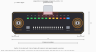
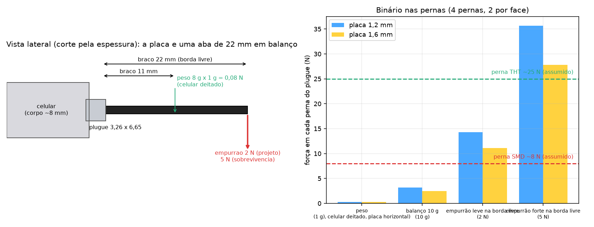
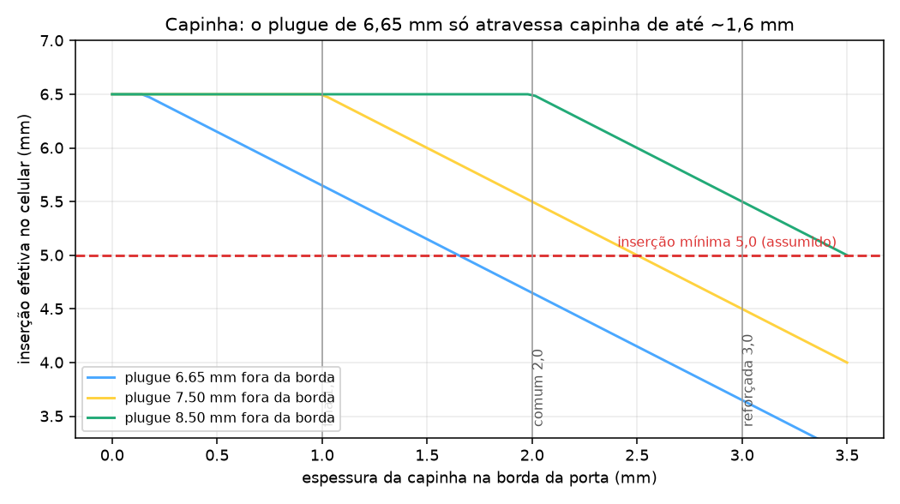
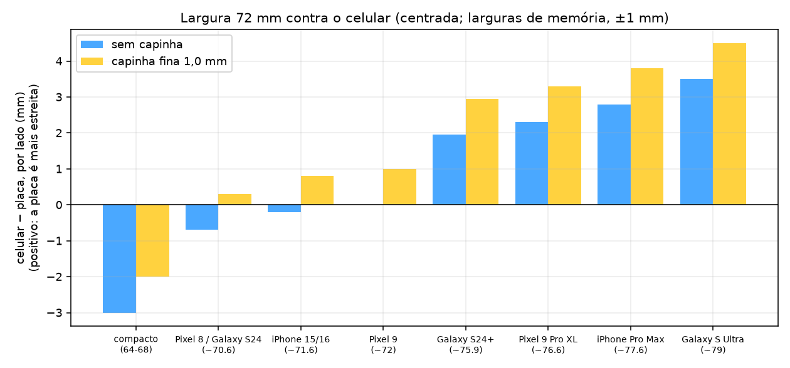
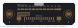

# Liebling (Batschauer), FIT_CHECK, R3MIC, versão A (D1, D3 preliminar, nota de D2)

Agente: `mic-design`. Revisão atendida: **R3MIC** (só a A; B e C congeladas). Data: 28 nov 2026. Nada foi comprado, medido em peça real nem
conferido em celular: tudo abaixo é conta de projeto, com as premissas marcadas **ASSUMIDO** (a Fase 2 as troca por medição).
Arquivos: `minimic/design/pcb_envelope.json` (contrato), `gerar_envelope.py`, `estudo_alavanca.py` / `estudo_alavanca.json`, figuras em `minimic/design/img/`.
Referência de posições: `proto_r3.py` (aprovado; não foi editado).

## 0. Resumo

1. **Espessura recomendada: 1,6 mm** (a SPEC diz 1,2). 1,2 mm resiste ao uso normal, mas a junção plugue-placa, não a casca do plugue, é o elo fraco
   na direção fraca (empurrão de lado, na espessura): com 1,2 mm cada perna recebe 14 N num empurrão de 2 N na borda livre; com 1,6 mm, 11 N, e a
   tensão da PCB com 2 N na ponta cai de 112 para 63 MPa. Custa +1,1 g (6,4 para 7,5 g). **É um pedido de mudança na SPEC** (ver §9, pergunta 1).
2. **Folga placa-celular: não contar com encostar.** A geometria do plugue (6,65 mm) deixa a borda da placa a 0 a 0,55 mm do celular nu (nominal 0,15):
   é o plugue que decide, e encostar não ajuda contra o empurrão de lado (o braço de apoio é a espessura da placa, 1,2 mm). Mirar **0,5 mm**.
3. **Capinha:** com plugue de 6,65 mm e inserção mínima de 5,0 mm (ASSUMIDO), a capinha na borda da porta pode ter **até ~1,6 mm** (fina). Capinha de 2 mm
   pede plugue de ≥ 7,0 mm de comprimento externo; de 3 mm, ≥ 8,0 mm. Rebaixos maiores na capinha, só medindo.
4. **Largura 72 mm** serve a celulares de 66 a 79 mm: a placa passa até 3 mm de cada lado nos compactos (66 mm) e fica até 3,5 mm mais estreita por lado nos largos (79 mm); do 70 ao 77 mm a diferença é de −0,7 a +2,8 mm por lado.
5. **Riscos principais:** junção do plugue (ver 1), folga de 0,16 mm do receptáculo que deixa a placa balançar ±1,7° (±0,3 mm no microfone: ruído de manuseio),
   plugue do protótipo desenhado com o tamanho do *receptáculo* (8,94 x 3,26) e não o do plugue real (8,25 x 2,40), anel dourado do microfone tocando os cantos do encapsulamento.

## 1. Contrato `pcb_envelope.json` (formato)

Dono: design. A eletrônica **lê**; mudança é pedida no relatório. Gerado por `gerar_envelope.py` (só stdlib), com `img/envelope.svg` de conferência.

**Quadro:** origem no canto superior esquerdo da placa, vista de cima (face de componentes = F.Cu); **x** para a direita (0..72); **y para baixo** (0..22),
o mesmo sentido do KiCad, **sem espelhar**; y = 0 é o lado do plugue; z = 0 é a face de baixo, 1,2 a de cima (plugue centrado em z = 0,6). Peças na face de
baixo: espelhar só em x.

| chave | conteúdo |
|---|---|
| `board` | tamanho 72 x 22, espessura 1,2 (alternativa `thickness_alternative` = 1,6), `outline` (com entalhe, 12 vértices) e `outline_no_notch`, chanfros 3 (frente) e 1,5 (atrás), cobre a ≥ 0,3 da borda, área 1548,7 mm2, máscara preta fosca, ENIG |
| `plug` | J1 no centro x = 36; envelope 8,94 x 3,26 (conservador), 6,65 mm para fora da borda, 2,5 dentro; `notch` x 31,38 a 40,62, y 0 a 2,6 (folga 0,15 por lado); `leg_pad_zone` x 30,9 a 41,1, y 0 a 4,2 |
| `mics` | MK_L (6,5; 11), MK_R (65,5; 11): 59 mm entre si, a 6,5 das pontas; corpo 4 x 3; furo acústico Ø1,8 (do protótipo, a E1 confirma); anel dourado r 3,2 x 0,3; espuma Ø10 x 3 |
| `leds_meter` | M1..M12 (x = 15,9 + 3,65 i; y = 6,3): 11 de 0805 (6 verde, 3 amarelo, 2 vermelho) + M12 azul 1206 "SAT", com `dbfs`, `label`, `meaning` |
| `leds_gain` | G1..G15 (x = 21,5 + 29/14 i; y = 15,5): 0603 branco girado 90 graus, `gain_db` = 3 i (0 a +42) |
| `buttons` | SW_DN (16; 15,5) e SW_UP (56; 15,5), corpo 3,4 x 2,6, pads estimados 4,2 x 3,4 |
| `keepouts` | espuma (sem peça, sem silk, sem peça alta), furo acústico (sem cobre de outra rede), zona do plugue (sem peça, sem silk), zona de flexão (sem cerâmico/cristal/peça grande, x 26 a 46, y 0 a 6), cobre à borda 0,3 |
| `gold` | anéis dos microfones, linha de contorno (0,22 mm, 0,8 da borda, polilinha), marca "Liebling" (caixa), faixa do plugue |
| `silkscreen_proposal` | textos de D3 (altura 1,0, largura 0,8, traço 0,15), com posição do centro |
| `heights` | LED 0,6/0,7, botão 1,6, microfone 1,0, espuma 3,0 acima da placa, **altura total 4,2 mm** |

Estado: posições de LEDs, botões e microfones são **definitivas** (as do protótipo aprovado); tamanhos de pads são **estimados** (a eletrônica troca pelo footprint real).

## 2. Estudo da alavanca do plugue no centro

Eixos: o plugue entra no celular ao longo de −v (do lado y = 0 da placa); a placa fica no plano do corpo do celular, com a face larga (72 mm) paralela às costas.
**Direção fraca** = carga na espessura da placa (de lado); **forte** = carga no plano da placa (o plugue tem 8,25 mm nesse sentido: sem problema).

### 2.1 Massa (conta)

| item | g |
|---|---|
| FR-4, 1548,7 mm2 x 1,2 mm x 1,85 g/cm3 | 3,44 |
| cobre, 2 camadas x 35 um x 50 % de cobertura | 0,49 |
| 27 LEDs a 0,015 | 0,41 |
| 2 botões a 0,10 | 0,20 |
| RP2040 0,10 + flash 0,03 + LDO 0,03 + 2 microfones 0,02 | 0,20 |
| ~60 passivos a 0,003 | 0,18 |
| cristal, máscara/ENIG/solda, 2 espumas | 0,05 + 0,15 + 0,06 |
| **placa sem plugue (1,2 mm)** | **5,17** |
| plugue USB-C metálico (ASSUMIDO 0,9 a 1,5) | 1,2 |
| **total com 1,2 mm** | **6,4 g** (faixa 5,5 a 7,5; pior caso usado nas contas: 8 g) |
| **total com 1,6 mm** | **7,5 g** (placa 6,31 + plugue 1,2) |

### 2.2 Cargas (definidas e justificadas)

Centro de massa a **11 mm** da borda do plugue (plugue na borda, resto simétrico; botões e microfones puxam um pouco para a frente), mais **0,5 mm** de folga placa-celular.

| caso | força | braço até a junção | porquê |
|---|---|---|---|
| peso, celular deitado (placa horizontal, direção fraca) | 0,08 N (8 g x 1 g) | 11,5 mm | com o celular em pé e o plugue embaixo o peso é **axial** (0,08 N contra a retenção do USB-C, de 8 N ou mais, de memória): sem momento |
| balanço do pau de selfie, 10 g | 0,79 N | 11,5 mm | aceleração de um balanço forte |
| **empurrão leve na borda livre: carga de projeto** | **2 N** (~0,2 kgf) | 20 mm | roçar na roupa, no estojo, na estante |
| empurrão forte na borda livre: carga de sobrevivência | 5 N (~0,5 kgf) | 20 mm | apoiar a mão, encostar na parede |
| empurrão na ponta (microfone), x = 70 | 2 N e 5 N | torque de 34 mm em torno do eixo do plugue | o pior para a flexão da placa e para o torque na junção |

### 2.3 Resultados

**Casca do plugue** (8,25 x 2,40, parede 0,25, ASSUMIDO aço/latão encruado, escoamento 200 MPa): Z = 4,23 mm3, momento de escoamento 846 N.mm.
Nos casos acima o momento vai de 0,9 a 100 N.mm: **tensão de 0,2 a 24 MPa, ~12 % do escoamento no pior**. A casca não é o problema.

**Junção plugue-placa** (4 pernas soldadas, 2 por face da placa, binário com braço = espessura + 0,2 mm; capacidade ASSUMIDA 25 N por perna THT, 8 N por perna SMD):

| caso | momento (N.mm) | força por perna, 1,2 mm | 1,6 mm | margem THT 1,2 / 1,6 | margem SMD 1,2 / 1,6 |
|---|---|---|---|---|---|
| peso (1 g) | 0,9 | 0,3 N | 0,3 N | 78 / 100 | 25 / 32 |
| balanço 10 g | 9,0 | 3,2 N | 2,5 N | 7,8 / 10,0 | 2,5 / 3,2 |
| **empurrão 2 N na borda livre** | 40 | **14,3 N** | **11,1 N** | **1,75 / 2,25** | **0,56 / 0,72** |
| empurrão 5 N na borda livre | 100 | 35,7 N | 27,8 N | 0,70 / 0,90 | 0,22 / 0,29 |
| empurrão 5 N na ponta (torque, 7 mm entre pares de pernas) | 170 | 12,1 N | 12,1 N | 2,1 / 2,1 | 0,66 / 0,66 |

Leitura: **pernas SMD não servem** (falham já em 2 N); com 4 pernas THT a carga de projeto passa com margem 1,75 (1,2 mm) ou 2,25 (1,6 mm), e a de sobrevivência
(5 N) fica no limite em ambas (margem 0,7 e 0,9), por isso o §2.6 propõe um reforço de montagem. O empurrão máximo que a junção THT aguenta na borda livre é **3,5 N com 1,2 mm e 4,5 N com 1,6 mm**.

**Flexão da própria PCB** (grelha de vigas 0,5 mm, `estudo_alavanca.py`; E = 17 GPa, engastada no contorno do entalhe: melhor caso; validada contra viga em balanço, razão 0,91; tensão nominal, sem fator de concentração, que nos cantos do entalhe é ~2,5):

| carga | 1,2 mm: deflexão / tensão | 1,6 mm: deflexão / tensão |
|---|---|---|
| peso (1 g) | 0,003 mm / 0,7 MPa | 0,001 mm / 0,5 MPa |
| 10 g | 0,025 mm / 6,7 MPa | 0,013 mm / 4,6 MPa |
| 2 N na borda livre (x = 36) | 0,07 mm / 36 MPa | 0,03 mm / 20 MPa |
| 5 N na borda livre | 0,18 mm / 89 MPa | 0,08 mm / 50 MPa |
| **2 N na ponta (x = 70)** | **0,49 mm / 112 MPa** | **0,21 mm / 63 MPa** |
| 5 N na ponta | 1,24 mm / 280 MPa | 0,52 mm / 157 MPa |

O admissível adotado é 100 MPa (FR-4 rompe a ~350 a 450 MPa na flexão; descontados cobre, fadiga e concentração). Com 1,2 mm um empurrão de 2 N **na ponta** já passa disso; com 1,6 mm não. A primeira frequência de flexão de cada
asa é ~480 Hz (1,2 mm) ou ~670 Hz (1,6 mm): o peso (0,003 mm) não flexiona a placa, mas a asa e o microfone da ponta captam vibração de manuseio acima de ~480 Hz; abaixo disso a placa se move como corpo rígido sobre o plugue.

### 2.4 Folga do receptáculo (o que mais pode incomodar o músico)

Receptáculo 2,56 mm contra casca 2,40: **0,16 mm de folga** em 5,5 mm de inserção, ou seja inclinação livre de **1,7 graus**: **0,65 mm na borda livre e 0,33 mm no microfone**, antes de qualquer esforço
chegar à junção. Isso é folga, não flexão: a placa estala e balança, e o microfone ouve. Mitigações a pedir (§9): um calço macio de 0,5 mm entre a borda da placa e o celular (que também pré-carrega o plugue) ou aceitar o ruído e filtrar abaixo de 15 Hz no firmware.

### 2.5 Encostar no celular ou ficar a 0,5 a 1 mm?

- **Encostar não ajuda na direção fraca:** a borda da placa (1,2 mm) como apoio dá um braço de 0,6 mm; o empurrão de lado continua inteiro na junção. Só ajuda no plano da placa, onde já sobra margem.
- **Encostar prende na borda arredondada** do celular e nos relevos da capinha: a placa fica inclinada e a carga entra pela quina da PCB (máscara lasca) e pelo celular.
- O plugue de 6,65 mm contra um receptáculo de 6,1 a 6,9 mm de profundidade (ASSUMIDO) deixa a placa a **0 a 0,55 mm** (nominal 0,15). A folga sai do plugue, não do desenho da placa.
- **Recomendação:** mirar **0,5 mm** de folga nominal (plugue exposto de 6,65 a 7,0 mm; mais longo só se a capinha pedir). uma folga de 1 mm leva a inserção a ~5,6 mm e soma +4 % de momento. Sem silicone: a SPEC fechou "nenhum case, nem faixa"; o calço de 0,5 mm do §2.4 é pergunta, não decisão.

### 2.6 Espessura: 1,2 ou 1,6 mm?

**1,6 mm.** O ganho é real mas não resolve tudo: -22 % de força nas pernas, -44 % na tensão da PCB com 2 N na ponta, -57 % de deflexão, +40 % na frequência da asa; o preço é +1,1 g (+18 %, ainda dentro dos 6 a 8 g da SPEC) e a placa de 1,6 é a espessura **padrão** da JLCPCB (sem custo extra; a 1,2 mm também não há extra para 2 camadas).
A E1 precisa conferir se o plugue meio-montado em entalhe aceita 1,6 (muitos aceitam de 1,0 a 1,6). O contrato traz a espessura em um só parâmetro (`board.thickness`, `thickness_alternative`).
**Reforço de montagem proposto para a sobrevivência de 5 N** (a gestão decide): um filete de epóxi ou cola UV na junção plugue-placa (passo de montagem, sem peça), ou um plugue com abas largas soldadas nas duas faces.

## 3. Folga para capinha e profundidade do rebaixo

Modelo: a placa fica **do lado de fora da capinha**, a borda a `tc` da superfície do celular (`tc` = espessura da capinha na borda da porta); o plugue só entra pela abertura. Inserção efetiva = mín(D_porta, L_plugue − tc),
com D_porta = 6,5 mm (6,1 a 6,9, ASSUMIDO) e inserção mínima de 5,0 mm (ASSUMIDO; contatos e retenção; a Fase 2 mede).

| capinha na borda da porta | plugue 6,65 | 7,5 | 8,5 |
|---|---|---|---|
| nu (0) | 6,5 | 6,5 | 6,5 |
| 1,0 (fina) | 5,65 ok | 6,5 | 6,5 |
| 1,5 | 5,15 ok (no limite) | 6,0 | 6,5 |
| 2,0 | 4,65 **não** | 5,5 ok | 6,5 |
| 2,5 | 4,15 **não** | 5,0 ok | 6,0 |
| 3,0 (reforçada) | 3,65 **não** | 4,5 **não** | 5,5 ok |

- **Capinha máxima com o plugue de 6,65: 1,65 mm** (6,65 − 5,0). Para uma capinha de 2 mm o plugue deve sair 7,0 mm ou mais; de 3 mm, 8,0 mm ou mais.
- **Profundidade mínima do rebaixo** que o plugue exige: o plugue de 6,65 mm **não tem rebaixo próprio**: ele precisa de uma abertura de 8,5 x 3,5 mm na capinha (casca 8,25 x 2,40 com folga) e de **no mínimo 5,0 mm de caminho livre** a partir da boca do receptáculo. Em capinha de 2 mm faltam 0,35 mm de inserção (4,65 contra 5,0): a capinha tem de ser rebaixada 0,35 mm em volta da porta, ou o plugue sair 7,0 mm.
- A **abertura da capinha** de muitas capas (12 a 14 x 6 a 7 mm) aceita o plugue; as que fecham a porta (com tampa) não aceitam.
- A placa de 72 x 22 não entra na abertura: **capinha com a borda de baixo arredondada ou com lábio** deixa a borda da placa tocar só num ponto; por isso a folga de 0,5 mm do §2.5.

## 4. Largura de 72 mm contra os celulares

Larguras **de memória** (±1 mm; a Fase 2 mede). Placa centrada no plugue; porta no centro do celular (ASSUMIDO; ±1 mm em alguns modelos, ver a coluna de deslocamento).

| celular | largura | sobra por lado (celular − placa) sem capinha | com capinha de 1 mm |
|---|---|---|---|
| compacto (64 a 68) | 66 | −3,0 | −2,0 |
| Pixel 8 / Galaxy S24 | 70,6 | −0,7 | +0,3 |
| iPhone 15/16 | 71,6 | −0,2 | +0,8 |
| Pixel 9 | 72,0 | 0,0 | +1,0 |
| Galaxy S24+ | 75,9 | +1,95 | +2,95 |
| Pixel 9 Pro XL | 76,6 | +2,3 | +3,3 |
| iPhone Pro Max | 77,6 | +2,8 | +3,8 |
| Galaxy S Ultra | 79,0 | +3,5 | +4,5 |

Negativo = a placa sai mais larga que o celular. O pior caso estético é o compacto (placa 3 mm para fora de cada lado). Do 70 ao 77 mm, a placa vai de 0,7 mm mais larga a 2,8 mm mais estreita por lado: sem problema mecânico.
A espessura do celular (7 a 9 mm) deixa a placa no meio (3,4 a 4,4 mm de cada face): as peças e a espuma (4,2 mm de altura total contados da face de baixo) ficam rente ou abaixo da face do celular nos de 7,5 mm ou mais; só um celular fino de ~6,8 mm teria a espuma 0,1 mm acima.

## 5. D3 (preliminar): LEDs, serigrafia e arte

### 5.1 Cor x número x significado (conferido contra a SPEC §3)

`proto_r3.py` (LEVELS, MEANING) **confere** com a SPEC nas 12 linhas:

| LED | cor | dBFS | significa |
|---|---|---|---|
| M1 a M6 | verde | −42, −36, −30, −24, −20, −16 | baixo, baixo, baixo, baixo, bom, bom |
| M7 a M9 | amarelo | −12, −9, −6 | forte (alvo dos picos do bayan) |
| M10 | vermelho | −3 | limite |
| M11 | vermelho | 0 | no teto |
| M12 | azul, "SAT" | (sem número) | saturou: pisca ~8 Hz por ~2 s e os dois vermelhos piscam junto |

Barra de ganho: 15 posições de 3 dB, 0 a +42; os rótulos 0, +12, +24, +36, +42 caem nos LEDs 1, 5, 9, 13, 15 (conta: 3 x índice), **certo**.

### 5.2 Texto sobre pad, texto sobre texto, tamanho (rodado por `gerar_envelope.py`; pads estimados, a eletrônica refaz com o footprint real)

**Do protótipo**, estimando a largura dos textos: **2 conflitos**:
1. "BATSCHAUER" (y 13,9) bate na descida do "g" de "Liebling" (descida até 13,4): texto sobre texto.
2. "BATSCHAUER" (x 14,7 a 22,8, y 13,2 a 13,9) fica sobre os pads do botão "−" (x 13,9 a 18,1, y 13,8 a 17,2): **texto sobre pad**.

**Ajustes de serigrafia necessários (todos entram na proposta do `pcb_envelope.json`):**

| # | ajuste | por quê |
|---|---|---|
| S1 | marca "Liebling" 1,0 mm para cima (linha de base 12,7 → 11,7) e "BATSCHAUER" no centro y = 13,0 | tira o texto de cima do "g" e dos pads do botão; a marca continua a ≥ 2,5 mm da fileira de LEDs do medidor |
| S2 | **todas as letras de 1,0 mm de altura, 0,8 de largura, traço 0,15** (o protótipo usa 0,7 mm de altura: abaixo do mínimo de serigrafia da JLCPCB) | legibilidade e fabricação |
| S3 | "SAT" com 1,2 mm de altura, centrado sobre M12 (já no protótipo) | o único texto do alerta |
| S4 | **anel dourado do microfone com raio 3,2 mm** (o do protótipo, 2,4, passa pelos cantos do encapsulamento 4 x 3, que estão a 2,5 mm do centro) | o anel tocaria os pads do microfone; dentro da espuma de raio 5 mm cabe |
| S5 | meter M11 (0805, x = 52,4) e M12 (1206, x = 56,05) com 3,65 mm de passo: **folga de 0,15 mm** entre pads (envelope estimado 2,95 e 4,05) | mínimo da JLCPCB para pads é ~0,15; pedir à eletrônica 0,3 mm a mais (SAT para x = 56,3), ou footprint de 1206 mais estreito |
| S6 | `LEVEL dBFS` e `GAIN dB`: não estão na lista de serigrafia mínima da SPEC §5 (número, +, −, L, R, SAT) | manter ou tirar: pergunta |
| S7 | o protótipo desenha a faixa dourada de 9 x 2,5 sobre o entalhe: é a área de solda do plugue, **não arte** | a eletrônica não a trata como marca |

Pontos que **estão certos**: números do medidor (3 mm de largura estimada contra 3,65 de passo), rótulos de ganho (4,1 mm entre "+36" e "+42"), "L" e "R" (y 19,4, longe da espuma e do chanfro), "−" e "+" (y 18,6, a 0,9 mm dos pads dos botões), a linha dourada a 0,8 da borda (≥ 0,4 mm de qualquer texto).
Nenhum texto fica sobre pad na **proposta** (0 conflitos). Figura: 

### 5.3 Arte
Linha dourada de 0,22 mm: abertura de máscara de 0,22 e cobre de 0,22 sobre a máscara preta; sem problema com o mínimo da fábrica (máscara a ≥ 0,1), mas a linha **não deve cruzar os pads do plugue** (ela fica aberta ±5,4 mm do centro, 0,9 mm do entalhe). Marca em cobre: caixa 12 x 2,9 mm em x 14,5 a 26,5, y 9,5 a 12,4.

## 6. D2 (espuma Ø10 x 3), nota

Nada muda na altura (4,2 mm contados da face de baixo, a espuma é o ponto mais alto) nem na posição: Ø10 centrado no furo a 1,5 mm da borda esquerda e da direita (nenhum LED a menos de 3,4 mm; o botão mais perto fica a 8,4 mm do centro da espuma). **Pergunta à eletrônica:** a face do som do IM72D128 (o protótipo põe o microfone e a espuma na face de cima; se a porta for inferior, o furo atravessa a placa e a espuma vai do lado do som). A zona "sem peça, sem silk" Ø10 está no contrato.

## 7. Pedidos à eletrônica (o que o contorno exige)

1. Ler `pcb_envelope.json`: **contorno com entalhe** de 9,24 x 2,6 no centro do lado de 72 mm; plugue **no meio da espessura** (z = 0,6), 6,65 mm para fora da borda.
2. **Plugue: 4 pernas THT** (não SMD: falha a 2 N) e que aceite 1,6 mm; casca 8,25 x 2,40 (o envelope 8,94 x 3,26 do protótipo é o do receptáculo); comprimento externo ≥ 6,65 (7,0 se possível, para capinha de 2 mm). Pads grandes, filete de solda dos dois lados.
3. **Zona de flexão** x 26 a 46, y 0 a 6: sem capacitor cerâmico, sem cristal, sem peça grande; trilhas largas; **cantos do entalhe com raio 0,3 mm** (concentração de tensão ~2,5).
4. Pads reais de botões, LEDs e microfone no lugar dos estimados; refazer a conferência de serigrafia (`gerar_envelope.py`) com eles.
5. M11 e M12 a mais de 0,2 mm de pad a pad (S5).
6. Espessura: **ver pergunta 1**; deixar `thickness` como parâmetro.

## 8. Riscos

| risco | gravidade | o que fazer |
|---|---|---|
| junção do plugue (empurrão de lado) | média/alta | 1,6 mm + 4 pernas THT + (opcional) filete de cola; teste de empurrão na Fase 2 |
| folga do receptáculo balança a placa (1,7 graus, ±0,3 mm no microfone) | média | calço macio de 0,5 mm (pergunta) ou filtro < 15 Hz; medir ruído de manuseio na Fase 2 |
| inserção na capinha de 1,65 mm ou mais | média | plugue mais longo (7,0 a 8,0 mm) se a gestão quiser atender capinha comum de 2 a 3 mm |
| anel dourado tocando os pads (S4) | baixa | raio 3,2 mm (já no contrato) |
| tamanho do plugue (envelope de 8,94 x 3,26 do protótipo) | baixa | usar o do datasheet; o contrato é conservador |
| celulares com a porta fora do centro ou com tampa/lábio na capinha | baixa | medir 3 celulares na Fase 2 |

Tudo aqui é conta; **nenhuma peça real foi medida** (Fase 1).

## 9. Perguntas para o design/gestão

1. **Espessura 1,6 mm no lugar de 1,2** (a SPEC §1 diz 1,2)? Recomendo 1,6 (§2.6); a gestão atualiza a SPEC ou mantém 1,2 sabendo da margem menor da junção (1,75 em vez de 2,25 contra o empurrão de projeto).
2. **Reforço de montagem** na junção do plugue (filete de epóxi/cola UV), para sobreviver a empurrão de 5 N? Ou aceitamos 4 N de limite?
3. **Calço macio de 0,5 mm** entre a borda da placa e o celular (adesivo, sem caixa), para pré-carregar o plugue e matar o balanço de 1,7 graus? A SPEC §8 proibiu "case e faixa de silicone"; um calço adesivo de espuma é outra coisa, mas é decisão do J.
4. **Capinha:** queremos atender capinha comum de 2 a 3 mm (plugue de 7,0 a 8,0 mm de comprimento externo) ou só capinha fina de até 1,6 mm (plugue de 6,65 mm)? É a E1 que acha a peça.
5. **Serigrafia:** manter `LEVEL dBFS`, `GAIN dB` e `BATSCHAUER`, que a SPEC §5 não lista (a lista diz "número, +, −, L, R, SAT")?
6. Para a **eletrônica (mic-eletronica)**: a porta do IM72D128 é superior ou inferior (muda a face da espuma e o furo acústico)? O furo Ø1,8 do protótipo é só do protótipo.
7. As larguras de celular acima são de memória: o J quer que a Fase 2 meça 3 celulares reais (um estreito, um largo e um com capinha comum) antes de fixar plugue e espessura?
